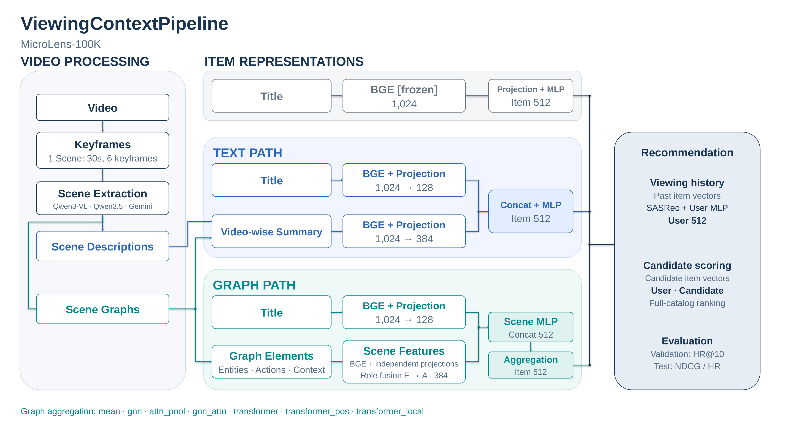
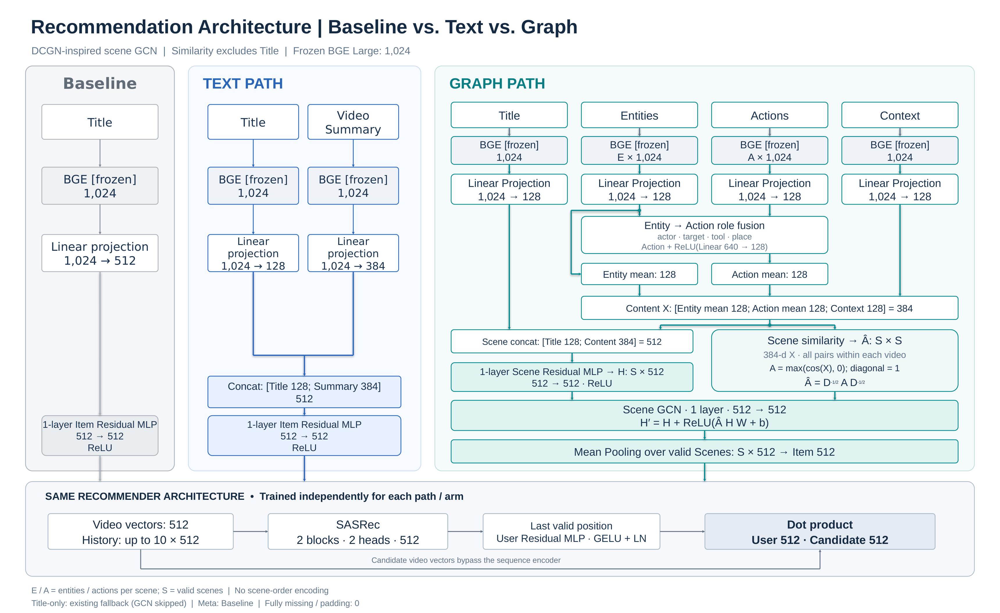

# ViewingContextPipeline

MicroLens-100K 영상에서 시청 맥락을 추출하고, **영문 제목에 영상 관측 정보를 더했을 때 추천 성능이 어떻게 달라지는지** 비교하는 실험 파이프라인입니다. Qwen·Gemini로 장면별 Graph와 Description을 생성하고, 동일한 사용자·후보 영상 목록(catalog)·평가 구간에서 SASRec을 학습합니다.

[연구실 자문 기록](docs/feedback_260923.md)의 장면 추출·영상 표현·사용자 표현에 관한 제안을 참고하여 설계를 정리했습니다. 특히 장면 표현의 유사도를 이용한 aggregation 제안을 반영해 **영상 내부 장면 사이에 정보를 전달하는 GCN 경로**를 구현했습니다. 아래에서는 피드백과 현재 구현의 대응 관계, 각 단계의 입력·출력, 세부 구현을 확인할 수 있습니다.

## Overview

영상에서 정보를 만드는 경로는 두 가지이며, 제목은 별도로 준비합니다.

- **Text 경로:** 키프레임 → Scene Graph 또는 Description → 영상 Summary → 고정 BGE 특징 → 학습한 영상 벡터
- **직접 Graph 경로:** 키프레임 → Scene Graph → 고정 BGE 특징·역할 연결 → 장면 표현 → mean·GNN·장면 Transformer → 학습한 영상 벡터
- **공통 추천:** 과거 시청 영상 벡터 → SASRec 사용자 벡터 → 후보 영상 벡터와 내적 → 추천 순위·평가 지표

**Graph를 요약문으로 사용하는 Text 경로와, 역할 연결을 사용하는 직접 Graph 경로는 구분합니다.** 직접 Graph 경로에는 Summary가 필요하지 않습니다. 제목은 Scene 추출·Summary 생성에 넣지 않고, 제목을 사용하는 실험 조건에서 영상 정보와 결합합니다.



위 그림의 직접 Graph 부분은 `mean` 경로를 보여줍니다. `gnn`은 Scene MLP와 Mean Pooling 사이에 장면 GCN을, `transformer` 계열은 같은 자리에 장면 Transformer를 추가합니다. [편집 가능한 PPTX](docs/design/main_diagram.pptx) · [그림 생성 코드](docs/design/generate_main_diagram.py)

## 설계 근거와 피드백 반영 범위

자문 모듈 1·2·3을 현재 코드의 장면 추출·영상 표현·사용자 표현에 연결합니다. **제안을 반영한 구현, 기존 방식과의 대응, 후속 검토 항목을 구분**합니다.

| 피드백의 핵심 | 현재 설계와의 연결 | 반영 범위 |
| --- | --- | --- |
| 모듈 1: 역할별로 분해된 Graph의 추천 활용성을 평가 | Context·Entities·Actions를 추출하고, Entity→Action 역할 연결을 영상 표현에 사용 | 현재 구현. Graph/Description 비교 경로를 함께 유지 |
| 모듈 2: 장면 표현의 유사도를 이용한 GCN aggregation | 제목을 제외한 장면 특징으로 영상 내부 연결을 만들고, 1층 residual GCN 후 평균 집계 | 제안을 참고한 구현. 동일 조건의 mean/gnn 추천 품질 비교는 별도 실험 |
| 모듈 3: 사용자와 아이템을 동일한 feature space에 투영 | SASRec으로 시청 이력을 인코딩한 사용자 벡터와 후보 영상 벡터를 내적으로 비교 | 제안과 대응하는 현재 방식. 사용자 평균·LightGCN·clustering 비교는 후속 검토 |

모듈 1의 영상 간 노드 공유·어휘 정규화, 모듈 2의 계층적 DCGN·UniMP·CSA는 후속 검토 범위입니다. 현재 GCN은 **한 영상 내부의 장면들**을 연결하며, 자문에서 언급한 방법 전체를 재현한 구현은 아닙니다. 원문 제안은 [자문 기록](docs/feedback_260923.md), 구현 상태와 선행 조건은 [프로젝트 이정표](docs/TODO.md)를 참고하세요.

| 설계 선택 | 비교에서의 역할 |
| --- | --- |
| 제목을 생성 입력에서 제외하고 추천 단계에서 결합 | 영상 관측 기반 정보를 제목과 분리해 준비하고, 제목 사용 여부를 실험 조건으로 명시 |
| Graph와 Description을 모두 생성 | 같은 추출 모델에서 구조화 관측과 자연어 관측을 비교할 입력 제공 |
| 동결 BGE와 학습 가능한 영상 encoder를 분리 | 고정 텍스트 특징을 준비한 뒤, projection·역할 결합·집계를 추천 목적함수로 학습 |
| 사용자·catalog·평가 구간을 공통으로 유지 | 표현별로 평가 대상을 달리하지 않도록 구성. 결측 정보 때문에 아이템·interaction을 제거하지 않음 |
| 사용자별 leave-one-out 평가 | 사용자별 마지막 상호작용은 test, 직전은 validation으로 보류하고 최적 checkpoint를 평가 |

BGE Large, 30초 창·6개 키프레임, 각 성분의 차원 배분은 현재 구현·설정 값입니다. 이 값의 최적성이나 추천 성능 개선을 주장하려면 별도의 비교 실험이 필요합니다.

## 단계별 입력과 출력

실행 모듈은 `preparation → extraction → validation` 순서입니다. 연구 모듈 2·3은 모두 `validation` 안에 있으며, 영상·사용자 표현 학습은 `run-recommendation`에서 함께 수행합니다.

| 단계 | 입력 | 처리 → 출력 | 명령·담당 코드 |
| --- | --- | --- | --- |
| 1. 데이터 준비 | 사용자–영상–시간 기록, 제목, 영상 목록 | 원본 검증·제목 보완 → 전체 원본 catalog, interaction, 제목 매핑 | `prepare-cohort` · [preparation](src/preparation/cohort.py) |
| 2. 영상 관측 준비 | 영상 파일, sampling 설정 | 시간 창별 프레임 추출 → 키프레임 이미지·timestamp | `prepare-input-data` · [입력 준비](src/preparation/input_data.py), [sampling](src/visual_sampling.py) |
| 3. 장면 정보 추출 | 키프레임, Graph/Description 프롬프트 | Qwen/Gemini 추론·파싱 → 장면별 Graph 또는 Description JSONL | `extract-graph-scenes` / `extract-description-scenes` · [extraction](src/extraction/steps.py) |
| 4. 영상 요약 — Text 경로 | 장면별 관측, Summary 프롬프트 | 영상 단위 영문 요약 → Summary JSON | `summarize` · [Summary 실행](src/extraction/summary_executor.py) |
| 5. 평가·고정 특징 준비 | 원본 이력, 제목·Summary 또는 Graph 요소·역할 연결 | 사용자 필터·최근 13개·마지막 2개 분할·평가 catalog 구성; 동결 BGE 인코딩 → 1024차원 특징, 가용성 마스크; Graph는 노드·edge·장면 경계도 저장 | `embed-representations` · [분할](src/validation/leave_one_out_data.py), [Text 특징](src/validation/steps.py), [Graph 입력](src/validation/graph_inputs.py) |
| 6. 영상 표현 학습 | 고정 특징, Graph 구조 | projection·MLP·역할 결합·장면 집계 → 영상당 512차원 벡터 | `run-recommendation` 내부 · [Text 모델](src/validation/model.py), [Graph 모델](src/validation/graph_model.py) |
| 7. 사용자 표현·추천 평가 | 과거 시청 영상 벡터, 후보 영상 벡터, 평가 계획 | SASRec·내적·순위 평가 → checkpoint, 학습 기록, 이벤트별 지표 | `run-recommendation` · [leave-one-out 학습·평가](src/validation/leave_one_out_recommendation.py) |
| 8. 진단 | 이벤트별 지표, 추출·표현·학습 기록 | 검증·집계 → 최종 HR/NDCG·수치 비교만 저장한 진단 JSON | `run-diagnosis` · [Text 진단](src/validation/leave_one_out_diagnosis.py), [Graph 진단](src/validation/graph_diagnosis.py) |

**5단계에서 저장하는 것은 고정 입력 특징입니다. 최종 추천용 영상 벡터는 6단계의 학습된 모델이 생성합니다.** 영상의 장면 순서와 사용자의 시청 순서도 다릅니다. 현재 mean/GCN에는 장면 순서 인코딩이 없으며, SASRec은 사용자의 시간순 시청 이력을 처리합니다.

## 모듈별 동작과 세부사항

### 모듈 1. 키프레임에서 장면 정보를 추출합니다

기본 설정은 30초 고정 시간 창, 창당 6개 키프레임, 640×352 해상도입니다. 마지막 짧은 창은 키프레임이 더 적을 수 있습니다. 여기서 Scene은 시간 창을 뜻하며, 의미적 장면 전환을 검출한 결과는 아닙니다. 입력은 시각 정보만 사용합니다.

[모듈 1 피드백](docs/feedback_260923.md#모듈-1-관련-scene-to-graph-generation)은 역할 분해와 추천 활용성의 관점에서 Graph를 평가하도록 제안했습니다. 현재 Graph는 누가(actor), 무엇을 하는지(action), 무엇에(target), 어떤 도구로(tool), 어디에서(place)를 분리합니다. Description은 같은 시각 관측을 자연어로 표현합니다.

<details>
<summary>장면 출력 예시와 프롬프트·저장 형식</summary>

아래는 형식을 설명하기 위한 예시이며 실제 Run의 생성 결과가 아닙니다. v8 Graph의 모델 출력은 다음과 같은 텍스트입니다.

```text
[Context]
medium: live_action
format: demonstration
topics: food preparation
[Entities]
p1: person; wearing apron
f1: tomato
t1: knife
l1: kitchen
[Actions]
p1 - cutting - f1; t1; l1
```

이를 파싱하여 `scene_graph` 객체로 저장합니다. 역할에는 선언된 Entity ID 또는 `none`·`unknown`을 사용합니다. `none`은 부재·비해당, `unknown`은 식별할 수 없는 값이며, ID는 장면 내부에서만 유효합니다. Description 예시는 `A person wearing an apron cuts a tomato with a knife in a kitchen.`과 같은 자연어입니다.

- Graph 프롬프트: [scene_graph_v9.md](prompts/scene_graph_v9.md)
- Description 프롬프트: [scene_description_v3.md](prompts/scene_description_v3.md)
- 저장: `extraction/scenes/<source>/<content_id>.jsonl`. Graph 행에는 `scene_graph`·`warning`, Description 행에는 `description`이 들어갑니다. 공통으로 콘텐츠·장면 식별자와 토큰 사용량을 기록합니다.
- 구조화하지 못한 Graph 출력은 원문으로 보존합니다. 원문 관측은 Text Summary에 사용할 수 있지만, 직접 Graph 학습에는 구조·warning 검사를 통과한 장면만 사용합니다.

구조화 Graph는 현재 Context·Entities·Actions 형식만 지원하며, Actions는 `actor - action - target; tool; place`입니다. v9의 개체 이름 참조는 공백·번호를 포함해 정확히 연결하고 장면별 내부 ID로 변환합니다. 기존 `id: kind` 선언도 지원합니다. Relations·receiver·place 누락과 구형 `location` 필드를 자동 보정하지 않습니다. Scene은 현재 compact 필드만, Summary는 `video-summary/v5`의 `complete`·`failed`와 명시적인 `provenance.summary_model`만 읽습니다. 지원 밖 기존 입력은 경로와 원인을 포함한 오류로 거부하며 일반 재실행에서 변환하거나 덮어쓰지 않습니다. 현재 형식의 파일은 모델·프롬프트·생성 설정·장면 입력이 일치할 때 재사용합니다. Scene 디렉터리의 `generation_identity.json`으로 compact payload의 생성 조건을 확인하며, 불일치하면 `--force` 또는 새 Run이 필요합니다. 새 비지원 Graph 응답은 원문과 warning을 보존합니다.

Text 경로의 Summary는 장면 관측을 영상 단위 자연어로 모읍니다. [Graph Summary](prompts/summary_graph_v9.md)와 [Description Summary](prompts/summary_description_v5.md)의 입력에는 제목이 없으며, `{scenes}`가 필요하고 `{english_title}`은 허용하지 않습니다. 출력은 `extraction/summaries/<source>/<content_id>.json`에 텍스트·상태·장면 수·단어 수·토큰 수·생성 출처(provenance)와 함께 저장합니다.

저장·파싱·실패 처리의 계약은 [실행·저장 계약](docs/runtime.md)의 **Scene·Summary 저장** 절을 참고하세요.

</details>

### 모듈 2. 장면 관측을 추천용 영상 벡터로 만듭니다

Text 경로는 제목과 Summary를 각각 BGE로 인코딩하고, 학습한 projection과 MLP로 결합합니다. 직접 Graph 경로는 Entity·Action·Context를 각각 인코딩하고, 역할에 연결된 Entity 정보를 Action 표현에 반영한 뒤 장면 표현을 만듭니다.

[모듈 2 피드백](docs/feedback_260923.md#모듈-2-관련-representation-generation-from-scene-graph)에서는 각 Scene Graph를 하나의 장면 표현으로 보고, 표현 간 유사도에 기반한 GCN으로 정보를 전달하는 방법을 제안했습니다. 현재 **장면을 바로 평균하는 `mean`** 경로에 더해, 이 제안을 참고한 **영상 내부 장면 간 전달 후 평균하는 `gnn`** 경로를 구현했습니다. Entity→Action 역할 결합과 장면 간 GCN은 서로 다른 연산입니다.

장면 간 상호작용과 장면 순서의 효과를 나누어 보기 위해, 같은 자리에 1층 Transformer를 넣는 `transformer`(위치 없음), `transformer_pos`(유효 장면 순번 위치), `transformer_local`(파라미터가 같고 장면 간 attention만 막은 대조군)도 구현했습니다. 추천 품질 비교는 아직 실행하지 않았습니다. 설계 근거는 [Graph 학습 문서](docs/graph_training.md#장면-transformer-aggregation-2026-10-12)를 참고하세요.

자문의 A–D 비교표를 채우기 위해 학습 attention 경로 두 개도 추가했습니다. `attn_pool`은 장면 간 교환 없이 영상 readout 가중치만 학습합니다. `gnn_attn`은 `gnn`과 같은 조건에서 cosine 가중치를 학습된 attention으로만 바꿉니다. 이 두 경로도 추천 품질 비교는 아직 실행하지 않았습니다. 설계 근거는 [Graph 학습 문서](docs/graph_training.md#장면-attention-aggregation-2026-10-12)를 참고하세요.

<details>
<summary>영상 encoder의 차원·수식과 mean/GNN 구조</summary>

공통 입력은 **동결 BGE large-en-v1.5의 1024차원 특징**, 출력은 **512차원 영상 벡터**입니다. BGE는 추천 학습에서 갱신하지 않으며 projection·역할 결합·MLP·GCN과 SASRec은 추천 loss로 함께 학습합니다.

| 경로 | 영상 벡터 계산 |
| --- | --- |
| 제목 기준선 `meta` | 제목 1024 → Linear 512 → 1층 Residual MLP |
| Text | 제목 1024 → Linear 128; Summary 1024 → Linear 384 → concat 512 → 1층 Residual MLP |
| Graph `mean` | Title·Entities·Actions·Context 각각 1024 → Linear 128 → 역할 결합 → 장면 concat 512 → 1층 Scene Residual MLP → 유효 장면 평균 |
| Graph `gnn` | 위 장면 표현 → 영상 내부 장면 GCN → 유효 장면 평균 |

Graph의 Entity 입력은 이름·속성, Action 입력은 동작 텍스트, Context 입력은 Format·Medium·Topics입니다. ID는 역할 연결을 구성하는 데 쓰며 BGE 입력에는 넣지 않습니다. 같은 영상·다른 영상의 Entity ID를 공유 노드로 합치지 않습니다.

Action은 연결된 actor·target·tool·place의 Entity 벡터로 보정합니다. 역할값 `none`과 `unknown`에는 역할별 학습 가능한 상태 벡터를 사용합니다.

```text
Action 보정 = Action + ReLU(Linear([Action; actor; target; tool; place]))
Scene = R([Title 128; Entity 평균 128; 보정된 Action 평균 128; Context 128])
R(x) = x + ReLU(Linear(x))
```

GNN 유사도 입력은 Scene MLP 이전의 `[Entity 평균; 보정된 Action 평균; Context]` 384차원이며 **제목을 제외**합니다. 각 영상의 모든 유효 장면 쌍에 대해 cosine의 음수는 0, self-loop는 1로 두고 대칭 degree 정규화합니다. 1층 residual GCN은 `H′ = H + ReLU(Â H W + b)`이고, 이후 평균하여 영상 벡터를 만듭니다. 유사도는 매 forward 다시 계산하며 gradient를 차단하지 않습니다.

Item·Scene은 Linear 512→512 하나와 ReLU로 구성하며 LayerNorm은 없습니다. SASRec과 기존 2층 GELU User MLP의 LayerNorm은 유지합니다. `meta`에는 GCN을 적용하지 않습니다. 현재 장면 aggregation은 `mean`·`gnn`·`transformer`·`transformer_pos`·`transformer_local`·`attn_pool`·`gnn_attn`을 지원합니다. 과거 산출물 이름인 Scene `attention`은 CLI에서 거절합니다. SASRec 내부 attention은 유지합니다.



영상용 Item·Scene MLP는 1층입니다. 모델 계약은 Text `sasrec-content-v8`, mean `sasrec-role-graph/v9`, GNN `sasrec-role-graph/v10`입니다. [GNN PPTX](docs/design/recsys_diagram_gnn.pptx) · [GNN 그림 갱신 코드](docs/design/generate_recsys_diagram_gnn.py) · [mean PNG](docs/design/recsys_diagram.png) · [mean PPTX](docs/design/recsys_diagram.pptx)

세부 수식·입력 문자열·결측·캐시 계약은 [직접 Graph 학습](docs/graph_training.md#모델-및-데이터-계약), GCN 구현 범위는 [장면 GCN aggregation](docs/graph_training.md#장면-gcn-aggregation-2026-10-06)을 참고하세요.

</details>

### 모듈 3. 시청 이력으로 사용자 표현과 추천 순위를 만듭니다

[모듈 3 피드백](docs/feedback_260923.md#모듈-3-관련-user-representation-generation-and-recommendation)은 사용자와 아이템을 동일한 embedding 공간에 투영하는 방향을 제안했습니다. 현재 구현은 이 방향과 대응하며, 과거 시청 영상 벡터를 SASRec에 입력해 사용자 벡터를 만들고 후보 영상 벡터와 내적으로 비교합니다.

영상 encoder와 SASRec은 seed·Arm별로 독립 학습합니다. 피드백에서 제시한 사용자 평균 aggregation, 사용자 embedding parameter 기반 방식, clustering 기반 표현과 현재 SASRec 구현은 구분하며, 후속 비교 상태는 [이정표](docs/TODO.md)에 기록합니다.

<details>
<summary>사용자 encoder·leave-one-out 학습·평가 방식</summary>

최근 최대 10개 시청 영상의 512차원 벡터에 위치 정보를 더해 SASRec의 2개 block·2개 head로 처리합니다. 마지막 유효 위치의 출력에 User Residual MLP를 적용해 512차원 사용자 벡터를 만듭니다. 후보 영상 벡터는 영상 encoder에서 직접 가져옵니다.

```text
추천 점수 = 사용자 벡터 · 후보 영상 벡터
```

원본 이력이 5개 이상인 사용자를 선택하고, `timestamp → 원본 event_id` 순서의 최근 13개 상호작용을 보존합니다. 마지막 날짜도 포함하며, 사용자마다 다음과 같이 나눕니다.

| 단계 | 데이터 | 입력 이력·역할 |
| --- | --- | --- |
| Train | 마지막 2개를 제외한 상호작용 | 앞선 이력으로 다음 아이템 전이를 학습 |
| Validation | 끝에서 두 번째 상호작용 1개 | train 이력으로 HR@10을 계산하고 최적 checkpoint 선택 |
| Test | 마지막 상호작용 1개 | train + validation 이력으로 선택된 checkpoint 평가 |

각 정답 앞의 최대 10개를 모델에 입력합니다. 동일 timestamp는 원본 행 순서로 결정하며, 첫 이벤트는 학습 정답으로 사용하지 않습니다. validation 이후 train+validation 재학습은 하지 않습니다. 후보 catalog는 보존된 사용자 시퀀스 전체의 아이템이며, 앞선 보존 이력 전체를 마스킹합니다. 반복 정답도 마스킹하며, 사용자별 `torch.argsort(scores, descending=True)`로 순위를 계산합니다. 동률 순서는 PyTorch·device 환경에 따라 달라질 수 있습니다. validation/test는 학습 정답·학습 빈도에 들어가지 않습니다. checkpoint 선택은 validation **HR@10**, 최종 보고·paired bootstrap의 주 지표는 **NDCG@10**입니다. 동점이면 최초 epoch를 유지하고, 기존 patience 5로 종료한 뒤 최적 가중치로 test를 한 번 평가합니다.

전처리는 [MicroLens 공식 SASRec 코드](https://github.com/microlens2023/microlens-dataset/blob/master/Code/VideoRec/SASRec/utils/load_data.py)의 최소 이력·시퀀스 절단·마지막 2개 보류 흐름을 따릅니다. 모델·손실함수까지 논문을 완전히 재현한 것은 아니며, 사용자별 분할은 전체 사용자 사이의 공통 시간 경계를 보장하지 않습니다.

기본 학습 설정은 AdamW, learning rate `1e-4`, weight decay `0.1`, batch `128`, 최대 `50` epoch, patience `5`, min_delta `0`, seed `42/43/44`, `deterministic: true`입니다. 실제 실행 설정은 [config.yaml](config.yaml)을 확인하세요.

</details>

## 실험 조건과 결과 해석

Arm은 **비교하는 실험 조건**입니다. 같은 Arm 이름이라도 `text`는 Summary를, `graph`는 Scene Graph 구조를 사용하므로 결과에는 표현 모드를 함께 명시합니다. 주 지표는 **NDCG@10**이며, 선택한 target의 모든 쌍을 같은 비교군으로 평가합니다.

| 평가 Arm (`--target`) | Text 입력 | 직접 Graph 입력 |
| --- | --- | --- |
| `meta` | 영문 제목 | 영문 제목 |
| `graph_qwen3vl` | Qwen Graph의 Summary | Qwen Scene Graph |
| `graph_qwen3vl_meta` | 제목 + Qwen Graph의 Summary | 제목 + Qwen Scene Graph |
| `graph_qwen3.5` | Qwen3.5 Graph의 Summary | Qwen3.5 Scene Graph |
| `graph_qwen3.5_meta` | 제목 + Qwen3.5 Graph의 Summary | 제목 + Qwen3.5 Scene Graph |
| `desc_qwen3.5_meta` | 제목 + Qwen3.5 Description의 Summary | 미지원 |
| `graph_gemini_meta` | 제목 + Gemini Graph의 Summary | 제목 + Gemini Scene Graph |
| `desc_qwen3vl_meta` | 제목 + Qwen Description의 Summary | 미지원 |
| `desc_gemini_meta` | 제목 + Gemini Description의 Summary | 미지원 |

접미사 `qwen3vl`·`qwen3.5`·`gemini`는 **Scene 추출 모델**을 뜻합니다. Summary 모델은 별도로 선택합니다. `graph_gemini`는 생성 소스이며, 평가 Arm으로는 `graph_gemini_meta`를 사용합니다.

Text의 Graph/Description 비교는 두 종류의 관측을 요약문으로 사용한 결과입니다. 직접 Graph의 구조 활용 효과나 mean/gnn의 효과는 해당 경로와 조건을 맞춘 비교로 확인해야 합니다. 현재 진단은 선택한 표현 모드·aggregation 안에서 수행하며, Text/Graph·mean/gnn 사이의 자동 paired 비교는 후속 항목입니다.

<details>
<summary>비교 질문·통계 설정과 구현 검증의 범위</summary>

| 비교 | 확인할 질문 |
| --- | --- |
| 각 Arm − `meta` | 제목 기준선 대비 영상 관측을 사용하는 조건의 차이 |
| `graph_qwen3vl_meta` − `desc_qwen3vl_meta`, Gemini의 동일 비교 | 같은 추출 모델의 Graph/Description Summary 조건 차이 — Text 경로 |
| `graph_qwen3vl_meta` − `graph_qwen3vl` | 제목을 함께 사용하는 조건의 차이 |
| `graph_gemini_meta` − `graph_qwen3vl_meta` | Scene 추출 모델 조건 차이 |

Text 전체 평가는 기본 설정에서 3 seed × 6 Arm, 총 18개 학습 조합입니다. HR·NDCG는 `K=4,8,10,20,30`에서 계산합니다. NDCG@10 비교에는 사용자 단위 paired bootstrap 10,000회를 사용하며, 사용자별 seed 평균을 구한 뒤 사용자에 동일 가중치를 둡니다. 각 seed의 사용자 평균도 보고합니다.

각 aggregation에서 선택한 target의 모든 쌍을 하나의 Bonferroni 비교군으로 두며, 보정 분모는 `n × (n−1) / 2`입니다(3 target: 3쌍, 전체 6 target: 15쌍). 비교 방향은 registry에서 뒤에 있는 Arm에서 앞의 Arm을 뺀 값이며 CLI 순서와 무관합니다. 주 비교·teacher reference 예외는 없습니다. `leave-one-out-diagnosis/v4`는 target·비교 수·보정 정책을 기록합니다. Run 간 비교는 선택된 동일 Graph Arm의 개수로 보정하며 서로 다른 aggregation을 섞지 않습니다. 비교 정의는 [통계 정책 코드](src/validation/diagnosis_statistics.py)에 있습니다.

구현 검증은 소형 입력의 수치·gradient·결측·재개·캐시와 작은 leave-one-out 학습·평가·진단을 다룹니다. 이 검증과 전체 데이터의 추천 성능 실험은 구분합니다. 현재 모델·GCN의 검증 기록은 [직접 Graph 학습](docs/graph_training.md), 후속 실험 상태는 [이정표](docs/TODO.md)를 참고하세요. Run별 성능·비용 분석은 `artifacts/runs/<RUN_ID>/reports/`에 보관하며 해당 입력·모델 계약과 함께 해석합니다.

</details>

## 실행 안내

이하 명령은 저장소 루트에서 실행합니다. 선택한 평가 경로와 Arm에 필요한 생성 단계만 실행하세요. 새 프롬프트·모델 실험은 **새 Run ID**로 시작하여 기존 산출물을 보존합니다.

<details>
<summary>설치·환경·설정과 Run 이름</summary>

Ubuntu/Bash와 Python 3.11 이상을 기준으로 합니다. 영상 준비에는 `ffmpeg`·`ffprobe`가 필요하며, 데이터와 모델 가중치는 미리 준비해야 합니다.

```bash
python -m pip install -e ".[qwen,gemini,train,embedding,dev]"
python -m pip check
```

Gemini 생성 환경은 `.[gemini,dev]`, 임베딩·추천 환경은 `.[train,embedding,dev]`로 설치할 수 있습니다. Gemini는 Vertex ADC와 해당 프로젝트·모델의 호출 권한이 필요합니다. Qwen은 로컬 checkpoint와 vLLM을 사용합니다.

[config.yaml](config.yaml)을 실행 환경에 맞게 수정합니다.

| 설정 | 내용 |
| --- | --- |
| `data.pairs_csv` | `user,item,timestamp` CSV. timestamp는 정수 밀리초 |
| `data.pairs_tsv` | 파일이 있으면 사용자별 interaction multiset을 CSV와 대조 |
| `data.videos_dir` | `{item_id}.mp4` 영상 디렉터리 |
| `data.titles_csv` | 영문 제목 원본 CSV |
| `data.titles_supplement_csv` | 필요한 아이템의 빈 제목·누락 행을 보완할 CSV. 선택 사항 |
| `models.qwen3vl`, `models.qwen3.5`, `models.bge` | 로컬 모델 디렉터리 |
| `models.gemini` | Vertex 프로젝트·위치·모델·생성 설정 |
| `extraction.visual_evidence` | 시간 창·키프레임 수·해상도 |
| `extraction.{graph,description}.{qwen3vl,qwen3.5,gemini}` | 모델별 Scene·Summary 생성 토큰 한도 |
| `validation` | cohort·평가 구간, BGE, 학습, 실행 자원, 통계 설정 |
| `artifacts_root` | 산출물 상위 디렉터리 |

아래 `new_run_id`는 사용할 새 Run 이름으로 바꾸세요. 설정 형식의 `experiment_config_version: v6`, 프롬프트 파일의 v8, 모델 계약의 Text v8·mean v9·GNN v10, Run 이름은 서로 다른 식별자입니다. Run 이름을 바꿀 때 설정 버전은 변경하지 않습니다.

```bash
export RUN_ID="new_run_id"
export CUDA_VISIBLE_DEVICES=0,1,2,3
```

Qwen·추천의 GPU 선택은 `CUDA_VISIBLE_DEVICES`로 지정합니다. 추천의 `--workers-per-gpu`는 GPU당 독립 학습 작업 수이며 기본값은 1입니다.

[run_script.sh](run_script.sh)는 단계별 명령을 보관한 수동 실행 스크립트입니다. 현재 Run 값은 `260930_v8`, 활성 명령은 두 Graph 소스의 Gemini 요약입니다. 전체 파이프라인 자동 실행 스크립트가 아니므로 필요한 명령·Run 이름을 확인해 조정하거나 아래 명령을 직접 사용합니다. [scripts/run_script_v7.sh](scripts/run_script_v7.sh)는 기존 v7 실행 기록으로 보존합니다.

</details>

<details>
<summary>1–2단계: 데이터·키프레임 준비</summary>

```bash
python -m preparation prepare-cohort --run-id "$RUN_ID"
python -m preparation prepare-input-data --run-id "$RUN_ID"
```

`prepare-cohort`는 전체 원본 interaction과 catalog를 준비하고 필요한 영상·제목을 검사합니다. Run별 leave-one-out 분할·평가 catalog는 `embed-representations`에서 준비하며, 전처리 요약은 `reports/leave_one_out_cohort.{json,md}`에 기록합니다. 보완 CSV를 지정하면 원본의 비어 있지 않은 제목을 우선하고, 필요한 빈 제목·누락 행만 보완합니다. 끝내 해결되지 않은 제목은 빈 문자열로 저장합니다. 보완 CSV를 지정하지 않은 경우 누락 행은 오류입니다. 원본 CSV는 수정하지 않습니다.

원본 목록만 먼저 확인하려면 `prepare-cohort --plan-only`를 사용할 수 있지만, 다음 단계 전에 전체 `prepare-cohort`를 완료해야 합니다. `prepare-input-data`는 정상적인 기존 프레임을 재사용합니다. 입력 준비는 Run 간 공유되므로 데이터셋이나 평가 구성이 다른 실험은 `artifacts_root`를 분리합니다.

</details>

<details>
<summary>3–4단계: Scene 추출·영상 Summary 생성</summary>

`--schema`에는 실제 존재하는 Markdown 프롬프트 하나를 지정합니다. 상대 경로는 저장소 루트 기준입니다. 생성 소스(`--arm`)는 `graph_qwen3vl`, `graph_qwen3.5`, `graph_gemini`, `desc_qwen3vl`, `desc_qwen3.5`, `desc_gemini`이며 결합 평가 Arm을 생성에 지정하지 않습니다.

```bash
python -m extraction extract-graph-scenes --run-id "$RUN_ID" --schema prompts/scene_graph_v9.md --model qwen3vl --arm graph_qwen3vl
python -m extraction extract-graph-scenes --run-id "$RUN_ID" --schema prompts/scene_graph_v9.md --model gemini --arm graph_gemini
python -m extraction extract-description-scenes --run-id "$RUN_ID" --schema prompts/scene_description_v3.md --model qwen3vl --arm desc_qwen3vl
python -m extraction extract-description-scenes --run-id "$RUN_ID" --schema prompts/scene_description_v3.md --model gemini --arm desc_gemini
```

Text 평가에는 선택한 소스의 Summary를 생성합니다. 아래 예시는 네 소스 모두 Gemini로 요약합니다. Qwen 요약에는 `--model qwen3vl`을 지정합니다.

```bash
python -m extraction summarize --run-id "$RUN_ID" --schema prompts/summary_graph_v9.md --model gemini --arm graph_qwen3vl
python -m extraction summarize --run-id "$RUN_ID" --schema prompts/summary_graph_v9.md --model gemini --arm graph_gemini
python -m extraction summarize --run-id "$RUN_ID" --schema prompts/summary_description_v5.md --model gemini --arm desc_qwen3vl
python -m extraction summarize --run-id "$RUN_ID" --schema prompts/summary_description_v5.md --model gemini --arm desc_gemini
```

같은 Run·소스에는 하나의 Summary 모델을 사용합니다. 모델을 바꾸려면 새 Run 또는 `--force`를 사용합니다. 기존 성공 결과는 프롬프트를 바꿔도 자동 갱신하지 않으므로 아래 재개 규칙을 확인하세요.

</details>

<details>
<summary>5–8단계: Text 특징 준비·추천·진단</summary>

```bash
python -m validation embed-representations --run-id "$RUN_ID" --target meta graph_qwen3vl graph_qwen3vl_meta graph_gemini_meta desc_qwen3vl_meta desc_gemini_meta --representation-mode text
python -m validation run-recommendation --run-id "$RUN_ID" --target meta graph_qwen3vl graph_qwen3vl_meta graph_gemini_meta desc_qwen3vl_meta desc_gemini_meta --representation-mode text
python -m validation run-diagnosis --run-id "$RUN_ID" --target meta graph_qwen3vl graph_qwen3vl_meta graph_gemini_meta desc_qwen3vl_meta desc_gemini_meta --representation-mode text
```

일부 Arm만 실행하려면 세 명령의 `--target` 목록을 줄입니다. 선택하지 않은 소스의 Summary는 요구하지 않습니다. 평가에는 `--target`과 `--representation-mode`를 항상 명시합니다.

</details>

<details>
<summary>5–8단계: 직접 Graph 특징 준비·mean/GNN 추천·진단</summary>

두 aggregation은 고정 Graph 입력을 공유합니다. 아래 명령은 `mean` 학습과 진단을 실행합니다.

```bash
python -m validation embed-representations --run-id "$RUN_ID" --target meta graph_qwen3vl graph_qwen3vl_meta graph_gemini_meta --representation-mode graph
python -m validation run-recommendation --run-id "$RUN_ID" --target meta graph_qwen3vl graph_qwen3vl_meta graph_gemini_meta --representation-mode graph --scene-aggregation mean
python -m validation run-diagnosis --run-id "$RUN_ID" --target meta graph_qwen3vl graph_qwen3vl_meta graph_gemini_meta --representation-mode graph --scene-aggregation mean
```

`gnn` 학습과 진단은 다음과 같습니다. 유효한 현재 Graph 입력이 있으면 재임베딩 없이 추천부터 실행합니다. GNN은 selection부터 새로 학습하고, mean과 다른 경로에 결과를 저장합니다.

```bash
python -m validation run-recommendation --run-id "$RUN_ID" --target meta graph_qwen3vl graph_qwen3vl_meta graph_gemini_meta --representation-mode graph --scene-aggregation gnn
python -m validation run-diagnosis --run-id "$RUN_ID" --target meta graph_qwen3vl graph_qwen3vl_meta graph_gemini_meta --representation-mode graph --scene-aggregation gnn
```

Graph 추천·진단에는 `--scene-aggregation mean|gnn`이 필요합니다. embedding과 Text에는 aggregation을 지정하지 않습니다. Description Arm은 직접 Graph에서 지원하지 않습니다.

학습 병목은 `run-recommendation`에 `--profile-every 100`을 추가해 측정합니다. 배치별 Graph 준비·전송·인코딩·역전파와 평가 시간을 콘솔·조합별 `profile.jsonl`에 기록합니다. [측정 항목과 해석](docs/graph_training.md#추천-학습-병목-프로파일링)을 참고하세요.

</details>

## 산출물과 재현

준비 결과는 공유하고, 추출·표현·추천·진단은 Run별로 저장합니다. **Run별 분석 코드·보고서·표·이미지는 `artifacts/runs/<RUN_ID>/reports/`에 보관합니다.**

<details>
<summary>산출물 디렉터리와 확인할 파일</summary>

```text
artifacts/
├── preparation/                         # 공유 cohort·영상 준비
│   ├── cohort/leave_one_out/
│   ├── resized_keyframes/<width>_<height>/ # 예: 640_352
│   └── source_assets/
├── runs/<RUN_ID>/
│   ├── extraction/
│   │   ├── scenes/<source>/
│   │   └── summaries/<source>/
│   ├── validation/
│   │   ├── cohort/
│   │   ├── representations/{text,graph}/
│   │   ├── recommendations/text/
│   │   ├── recommendations/graph/{mean,gnn}/
│   │   └── diagnosis/
│   └── reports/                         # Run별 분석 산출물
└── shared_cache/                        # 검증된 임베딩·Graph 입력·추천 결과
```

| 확인할 내용 | Run 아래 위치 |
| --- | --- |
| 장면 관측 | `extraction/scenes/<source>/<content_id>.jsonl` |
| 영상 Summary | `extraction/summaries/<source>/<content_id>.json` |
| Text 고정 특징 | `validation/representations/text/<arm>_embeddings.npz` |
| Graph 고정 특징·역할 연결 | `validation/representations/graph/<arm>_embeddings/`의 배열·manifest·statistics |
| 추천 학습·test | `validation/recommendations/text/seed_<seed>/<arm>/` 또는 `validation/recommendations/graph/<mean 또는 gnn>/seed_<seed>/<arm>/` |
| 진단 | `validation/diagnosis/text_diagnosis.json`, `graph_mean_diagnosis.json`, `graph_gnn_diagnosis.json` |

진단 JSON은 Arm별 최종 점수(`recommendations.means`), NDCG@10 수치 비교·신뢰구간과 성공/실패 판정만 저장합니다. 상세 분할·입력 provenance·seed별 이벤트 지표는 원래 cohort·표현·추천 파일에 보존합니다. 진단은 `leave-one-out-diagnosis/v3`이며 작은 평가 계약도 기록합니다. 이전 NDCG checkpoint·반복 정답 예외·catalog 동률 순서의 추천 결과는 재사용하지 않습니다. 같은 Run에서 `run-recommendation`으로 선택한 Arm을 재학습하면 기존 추천 파일을 교체하며, 이후 `run-diagnosis`를 실행하여 진단을 재생성하십시오. Scene·Summary·프레임·catalog와 일치하는 임베딩은 재사용합니다. 현행 평가 계약으로 학습된 결과는 재학습 없이 재진단할 수 있습니다.

추천 결과는 seed × Arm 단위로 `sasrec.pt`, `training.json`, `per_event_metrics.jsonl`, `complete.json`을 저장하며, 직접 Graph는 `catalog_vectors.npy`도 저장합니다. `training.json`의 train epoch별 validation 지표와 최종 test 지표는 구분합니다. 과거 `graph_attention_diagnosis.json`과 기존 Run 산출물은 보존합니다.

</details>

<details>
<summary>재개·실패 재시도·결측·캐시 규칙</summary>

- **생성 재개:** 같은 명령을 재실행합니다. 성공 Scene·Summary는 프롬프트나 설정이 달라져도 재사용합니다. 성공 결과를 갱신하려면 해당 단계에 `--force`를 지정합니다.
- **실패 재시도:** 두 Qwen 모델은 공식 repetition penalty `1.0`을 유지하며, 같은 명령을 재실행하면 실패 항목만 같은 생성 설정으로 재시도합니다. Gemini 실패는 재실행으로 재시도합니다.
- **실패 확인:** Scene은 `scenes/<source>/failures/<content_id>.jsonl`, Summary는 `summaries/<source>/failures.jsonl`을 확인합니다. 실패 Summary는 빈 텍스트로 저장합니다.
- **Text 결측:** 제목 또는 Summary 중 있는 값을 사용합니다. 누락 성분은 projection 후 0으로 마스킹하고, 둘 다 없으면 최종 영상 벡터는 0입니다.
- **Graph 결측:** 구조·warning 검사를 통과한 장면을 사용합니다. Entity·Action이 없으면 해당 슬롯은 0입니다. 장면 없이 제목만 있으면 제목 기반 Scene MLP 경로를 사용하고 GCN을 건너뜁니다. 제목과 유효 장면이 모두 없으면 최종 영상 벡터는 0입니다.
- **공통 데이터 유지:** 결측 때문에 아이템·interaction을 제거하지 않습니다. 손상 파일과 잘못된 provenance는 오류로 처리합니다.
- **추천 재개:** 완료 조합을 검증하고 재사용합니다. 미완료 조합은 처음부터 다시 학습하며 epoch 중간 재개는 하지 않습니다. 같은 경로의 재학습은 기존 조합을 대체하므로 보존할 실험에는 새 Run을 사용합니다.
- **캐시:** 현재 Run → 공유 캐시 → 새 계산 순서입니다. `--force`는 해당 단계의 로컬·공유 캐시 읽기를 우회합니다. Scene·Summary는 다른 Run에서 자동으로 가져오지 않습니다.

과거 Run의 파일은 보존하지만 과거 전용 설정·진단·변환 명령은 지원하지 않습니다. Run 이름만으로 호환성을 판단하지 않으며, 실제 입력·인코더·모델·학습 계약과 provenance를 확인합니다. 세부 저장 형식·캐시 키 규칙은 [실행·저장 계약](docs/runtime.md), Graph 재실행 범위는 [직접 Graph 학습](docs/graph_training.md)에 정리했습니다.

</details>


### Qwen 공식 생성 정책

신규 Run은 `qwen3vl` (Qwen3-VL-2B-Instruct), `qwen3.5` (Qwen3.5-2B), `gemini`를 지원합니다. 기존 `qwen` 별칭은 없으며 구형 Run은 자동 변환하지 않습니다. 설치 extra 이름 `qwen`과 공통 엔진 설정 `extraction.qwen`은 두 로컬 Qwen 모델의 공용 런타임을 뜻합니다.

| 모델 | 장면 추출 (VL) | 장면 기록 요약 (Text) |
| --- | --- | --- |
| `qwen3vl` | temperature 0.7, top_p 0.8, top_k 20, presence_penalty 1.5 | temperature 1.0, top_p 1.0, top_k 40, presence_penalty 2.0 |
| `qwen3.5` | temperature 0.7, top_p 0.8, top_k 20, presence_penalty 1.5 | temperature 1.0, top_p 1.0, top_k 20, presence_penalty 2.0 |

두 모델은 sampling을 사용하고 repetition_penalty 1.0, min_p 0.0을 유지합니다. Qwen3.5는 chat template에 `enable_thinking=False`를 명시합니다. 출력 한도는 Graph 장면 384, Description 장면 512, 요약 512입니다. 생성 정책은 모델별로 고정되며 예전 전역 greedy·penalty schedule 설정은 받지 않습니다. 기존 greedy 실험과의 결과 차이에는 decoding 변경 효과도 포함됩니다. 근거: [Qwen3-VL 공식 설정](https://huggingface.co/Qwen/Qwen3-VL-2B-Instruct#generation-hyperparameters), [Qwen3.5 공식 설정](https://huggingface.co/Qwen/Qwen3.5-2B#best-practices).

Qwen3.5 실행 예시:

```bash
python -m extraction extract-graph-scenes --run-id "$RUN_ID" --schema prompts/scene_graph_v9.md --model qwen3.5 --arm graph_qwen3.5
python -m extraction extract-description-scenes --run-id "$RUN_ID" --schema prompts/scene_description_v3.md --model qwen3.5 --arm desc_qwen3.5
python -m extraction summarize --run-id "$RUN_ID" --schema prompts/summary_graph_v9.md --model qwen3.5 --arm graph_qwen3.5
python -m extraction summarize --run-id "$RUN_ID" --schema prompts/summary_description_v5.md --model qwen3.5 --arm desc_qwen3.5
```

Text 평가의 추가 target은 `graph_qwen3.5 graph_qwen3.5_meta desc_qwen3.5_meta`입니다. Graph 모드는 `graph_qwen3.5 graph_qwen3.5_meta`를 모든 기존 aggregation에서 지원합니다.
