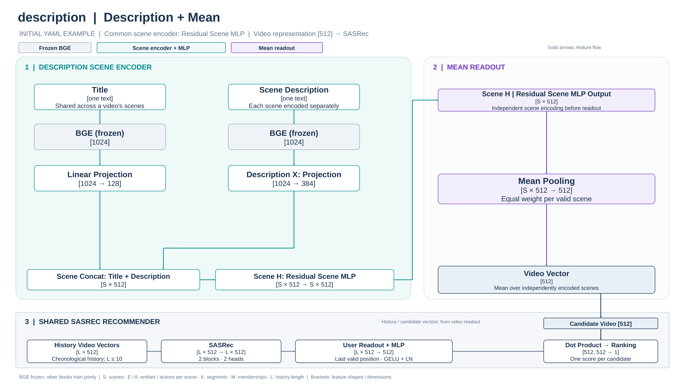
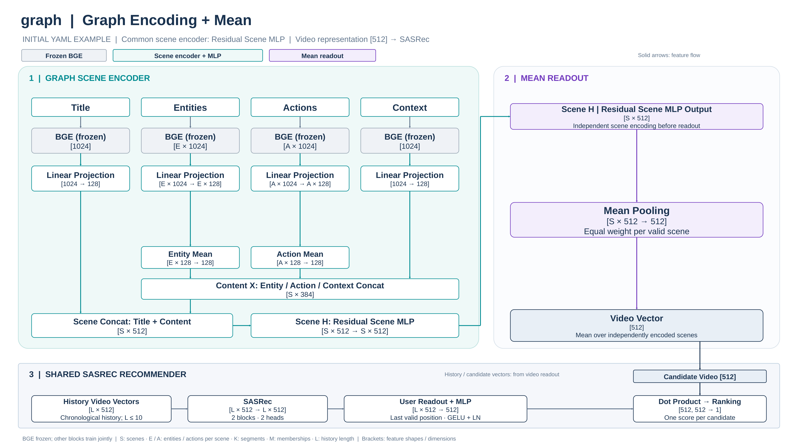
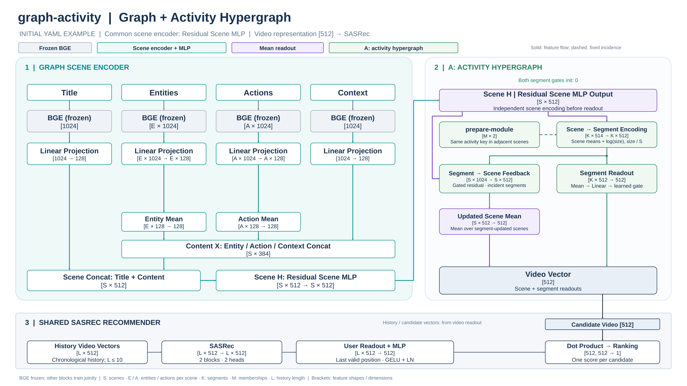
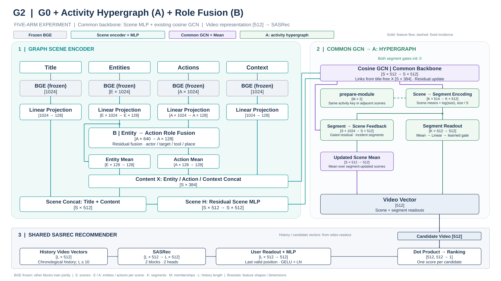

# ViewingContextPipeline

MicroLens-100K 영상 또는 M³L-10M 영화 예고편에서 맥락을 추출하고, **영문 제목에 영상 관측 정보를 더했을 때 추천 성능이 어떻게 달라지는지** 비교하는 실험 파이프라인입니다. 추천 실험은 Qwen3-VL-2B-Instruct의 장면별 Description·Scene Graph를 사용하며, 동일한 사용자·후보 영상 목록(catalog)·사용자별 분할에서 `base d g0 g1 g2` 5개 Arm을 학습·평가합니다. 다른 모델의 추출 기능도 별도로 유지합니다.

## 전체 흐름

- **Description:** 키프레임 → 장면별 Description → 고정 BGE → 제목 결합·Residual Scene MLP → 장면 Mean.
- **Graph:** 키프레임 → Scene Graph → 고정 BGE·역할 연결 → Arm별 Entity–Role Fusion·장면 인코더 → 장면 평균 또는 Hypergraph 집계·Action 구간 기여.
- **추천:** 과거 영상 벡터 → SASRec 사용자 벡터 → 후보 영상 벡터와 내적 → 추천 순위·평가 지표.

모든 Arm은 영문 제목을 사용합니다. 제목은 장면 추출에 넣지 않고 추천 인코더에서 결합합니다. BGE는 동결하고 장면 인코더·집계 모듈·SASRec은 추천 loss로 함께 학습합니다. 영상별 Summary 생성 단계는 제거했으며 기존 Summary 산출물은 보존합니다.

기존 [설계 그림](docs/design/main_diagram.png)은 이전 Summary·다중 집계 경로를 설명합니다. 현재 추천 Arm 5개의 정의와 실행 인터페이스는 아래 표를 기준으로 합니다.

[시작하기](#시작하기) · [단계별 입력과 출력](#단계별-입력과-출력) · [모듈 상세](#모듈별-동작과-세부사항) · [실험 조건](#실험-조건과-결과-해석) · [산출물·재현](#산출물과-재현)

## 시작하기

기본 실행 순서는 **데이터·키프레임 준비 → Qwen3-VL-2B-Instruct의 Graph·Description 추출 → BGE 특징·활동 구간 준비 → 5개 Arm 학습·진단**입니다. 저장소 루트에서 실행하며 Ubuntu/Bash·Python 3.11 이상과 `ffmpeg`·`ffprobe`가 필요합니다. 데이터와 Qwen·BGE 로컬 가중치를 미리 준비하고, Qwen 추출에는 Linux/CUDA와 비양자화 BF16 체크포인트를 사용합니다.

```bash
python -m pip install -e ".[qwen,train,embedding,dev]"
python -m pip check
export RUN_ID="new_run_id"
export DATASET="microlens_100k"  # 또는 m3l_10m
```

먼저 [config.yaml](config.yaml)의 `datasets.<dataset>.data`, `models.qwen3vl`, `models.bge` 경로를 실행 환경에 맞게 바꾸세요. Gemini 추출은 아래 선택 기능에서 설명합니다. **조건을 분리해 비교하거나 기존 결과를 보존하려면 새 Run ID를 사용합니다.** 정상 생성 결과는 프롬프트·penalty를 바꿔도 일반 재실행에서 재사용되므로 [재개 규칙](#산출물과-재현)을 확인하세요.

<details>
<summary>환경별 설치와 확인할 설정</summary>

Qwen 추출 환경은 `.[qwen,dev]`, 임베딩·추천 환경은 `.[train,embedding,dev]`로 나누어 설치할 수 있습니다. Qwen·임베딩·추천의 GPU는 `CUDA_VISIBLE_DEVICES`로 선택합니다. Qwen은 GPU당 하나의 엔진을 실행하고, 추천의 `--workers-per-gpu`는 GPU당 독립 학습 작업 수입니다(기본 1).

| config.yaml 항목 | 확인할 내용 |
| --- | --- |
| `datasets.microlens_100k.data` | interaction CSV·검증용 TSV, 영상 디렉터리, 제목·보완 제목 CSV의 경로 |
| `datasets.m3l_10m.data.root` | 다운로드한 M³L의 `metadata/`와 `videos/`를 포함하는 루트 |
| `datasets.<dataset>.source_counts` | 영상 제외 전 검증할 원본 사용자·상호작용·아이템 개수 |
| `models.qwen3vl`, `models.bge` | 기본 추천 실험에 사용하는 Qwen3-VL-2B-Instruct·BGE Large 로컬 디렉터리 |
| `models.gemini` | Gemini 호출 시 확인할 Vertex 프로젝트·위치·모델·생성 설정 |
| `extraction.visual_evidence` | 시간 창·키프레임 수·해상도 |
| `extraction.qwen`, `extraction.gemini` | 추론 엔진·동시 실행 설정 |
| `extraction.{graph,description}.{qwen3vl,gemini}` | Scene 출력 토큰 한도 |
| `validation.cohort` | 사용자 필터·보존 이력 길이 |
| `validation.encoder`, `validation.graph_execution` | BGE 인코딩·Graph 실행 자원 |
| `validation.model` | 학습 설정·seed·결정적 연산 사용 여부 |
| `validation.evaluation` | checkpoint 지표·평가 cutoff·통계 설정 |
| `artifacts_root` | 산출물 상위 디렉터리 |

MicroLens interaction CSV는 `user,item,timestamp` 형식이며 timestamp는 정수 밀리초입니다. 영상은 `{item_id}.mp4`로 준비합니다. TSV가 있으면 사용자별 interaction multiset을 CSV와 대조합니다. 제목 보완은 원본의 비어 있지 않은 제목을 우선하고 필요한 빈 제목·누락 행만 채웁니다. 보완 CSV를 사용해도 해결되지 않은 제목은 빈 문자열로 저장하며, 보완 CSV가 없을 때 제목 행 누락은 오류입니다. 원본 CSV는 수정하지 않습니다.

</details>

<details>
<summary>데이터셋 선택과 M³L-10M 입력</summary>

`protocol.dataset: [microlens_100k, m3l_10m]`은 지원 목록입니다. 모든 단계에서 `--dataset`을 명시하며, 한 명령은 한 데이터셋만 처리합니다. 같은 Run ID로 두 데이터셋을 실행해도 preparation·추출·학습·보고서·공유 캐시는 분리됩니다. 모델·추출·학습·평가 설정은 공유합니다. 선택하지 않은 데이터셋의 원본 파일은 없어도 됩니다.

M³L은 `datasets.m3l_10m.data.root`(현재 config: `/home_nvme/shared/data/m3l-10m`) 아래 파일을 사용합니다.

```text
metadata/ratings.dat
metadata/movies.dat
metadata/id_mmrec_to_grouplens.tsv
videos/{원본_GroupLens_movieId}.mp4
```

[공식 M³L 매핑](https://github.com/giuspillo/M3L_10M_20M)의 9,031개 영화로 원본 MovieLens 평점을 제한하고, 영상 제외 전 사용자 69,878명·평점 9,409,884개·영화 9,031개를 검증합니다. 원본 사용자·영화 ID를 유지하고 평점 timestamp(초)를 밀리초로 변환합니다. 제목은 `movies.dat`의 연도 포함 제목이며 장르·줄거리는 사용하지 않습니다.

**모든 평점을 상호작용으로 사용하며 평점 크기는 가중치로 사용하지 않습니다.** 영상이 없거나 영상 스트림·양의 재생시간을 확인할 수 없는 영화와 해당 상호작용을 제외합니다. `ffprobe` 누락·실행 권한 등 환경 오류는 준비를 중단합니다. 이후 기존 조건인 최소 이력 5개·최근 13개·마지막 2개 validation/test 분할을 적용합니다. 이는 **평가한 영화 이력의 다음 영화 예측**이며 공식 MMRec 분할 재현은 아닙니다.

`prepare-cohort`는 `cohort_plan.json`에 원본·영상 제외 후 통계와 입력 fingerprint를, `excluded_items.jsonl`에 제외 영화·사유·평점 개수를 저장합니다. 이후 다운로드한 영상은 기존 cohort에 자동 추가되지 않습니다. 확보 목록을 바꾸려면 `prepare-cohort`를 다시 실행하고 영향받는 후속 산출물을 재생성하세요. 서로 다른 데이터셋의 결과는 paired Run 비교로 결합하지 않습니다.

</details>

<details>
<summary>1–2단계: 데이터·키프레임 준비</summary>

```bash
python -m preparation prepare-cohort --run-id "$RUN_ID" --dataset "$DATASET"
python -m preparation prepare-input-data --run-id "$RUN_ID" --dataset "$DATASET"
```

`prepare-cohort`는 전체 원본 interaction과 catalog를 준비하고 필요한 영상·제목을 검사합니다. 원본 목록만 확인하는 `--plan-only`도 있지만 다음 단계 전에 전체 준비를 완료해야 합니다. `prepare-input-data`는 정상적인 기존 프레임을 재사용합니다. 준비 결과는 Run 간 공유하므로 데이터셋이나 준비 구성이 다른 실험은 `artifacts_root`를 분리합니다.

Run별 leave-one-out 분할·평가 catalog는 이후 `embed-representations`에서 준비하며 `reports/leave_one_out_cohort.{json,md}`에 전처리 요약을 기록합니다.

</details>

<details>
<summary>3단계: Qwen3-VL-2B-Instruct로 Graph·Description 추출</summary>

생성 명령에는 `--model qwen3vl`, 생성 소스인 `--arm`, Markdown 프롬프트 경로인 `--schema`를 지정합니다. `--arm`은 추천용 `d`, `g1` 등의 이름과 구분합니다. 상대 경로는 저장소 루트 기준입니다.

```bash
python -m extraction extract-graph-scenes --run-id "$RUN_ID" --dataset "$DATASET" --schema prompts/scene_graph_v9.md --model qwen3vl --arm graph_qwen3vl
python -m extraction extract-description-scenes --run-id "$RUN_ID" --dataset "$DATASET" --schema prompts/scene_description_v3.md --model qwen3vl --arm desc_qwen3vl
```

D는 `desc_qwen3vl`, G0·G1·G2는 `graph_qwen3vl`을 읽습니다. 두 추출 소스를 준비한 뒤 아래 특징 준비·학습·진단 명령을 실행합니다.

토큰 한도 초과 등으로 실패한 출력이 남으면 CLI는 종료 코드 `1`을 반환합니다. 완료된 출력은 보존되며 일반 재실행에서 실패·경고 출력만 재시도합니다. 파싱 경고는 실패와 구분해 집계하며 그 자체로 종료 코드 `1`을 반환하지 않습니다.

</details>

<details>
<summary>5개 Arm의 특징·활동 구간 준비 → 학습 → 진단</summary>

Graph·Description 추출을 마친 뒤 아래 순서로 실행합니다. 각 단계는 독립 명령이므로 앞 단계가 성공한 것을 확인한 뒤 다음 단계로 진행합니다.

```bash
ARMS=(base d g0 g1 g2)

python -m validation embed-representations --run-id "$RUN_ID" --dataset "$DATASET" --target "${ARMS[@]}"
# G2가 사용하는 활동 구간을 준비합니다.
python -m validation prepare-module --run-id "$RUN_ID" --dataset "$DATASET" --target g1 g2
python -m validation run-recommendation --run-id "$RUN_ID" --dataset "$DATASET" --target "${ARMS[@]}"
python -m validation run-diagnosis --run-id "$RUN_ID" --dataset "$DATASET" --target "${ARMS[@]}"
```

3개 seed 기준 15개 학습 조합·10쌍 비교입니다. `--target`은 필수이며 입력 순서와 무관하게 등록 순서로 처리합니다. Arm마다 입력·집계 방식이 고정되어 `--representation-mode`, `--scene-aggregation`, `--step basic/ablation`은 받지 않습니다. 추천 명령은 추출·임베딩·구간 준비·진단을 자동 실행하지 않습니다.

`prepare-module`은 Graph 특징 bundle을 만든 뒤 G1·G2 학습 전에 실행합니다. `--target g1 g2`로 공통 구간 파일을 한 번 준비하며 단독 G1·G2 선택도 지원합니다. `scene_segments.npy`·`scene_segments.json`에 기존 Action 문구 기반 활동 구간을 기록합니다. VLM·BGE를 다시 실행하지 않으며, Graph bundle이나 구간 생성 규칙이 바뀌면 다시 준비합니다.

D는 `desc_qwen3vl`의 유효 장면만 사용하며 Graph 파일·장면 목록·활동 구간에 의존하지 않습니다. D만 실행할 때는 Description 추출 뒤 `embed-representations --target d`, `run-recommendation --target d`, `run-diagnosis --target d`를 실행하며 `prepare-module`은 필요 없습니다. G0·G1·G2는 `graph_qwen3vl` BGE 특징을 공유합니다.

GPU당 독립 작업 수는 `--workers-per-gpu`로 지정합니다. 시작 로그의 `deterministic`은 `config.yaml`의 `validation.model.deterministic` 적용값입니다. 학습 중 epoch별 소요 시간과 처리량을 출력합니다.

</details>

<details>
<summary>선택 기능: Gemini 추출</summary>

기본 추천 실험의 시각 입력은 Qwen3-VL 장면 소스를 사용합니다. 아래 추가 모델의 추출 결과는 현재 추천 Arm에 자동 연결되지 않습니다.

Gemini를 호출할 때는 전용 패키지를 설치하고 `models.gemini`의 Vertex 프로젝트·위치·모델 설정, ADC 인증과 호출 권한을 확인합니다. Gemini 생성 환경은 기본 Qwen 환경과 분리할 수 있습니다.

```bash
python -m pip install -e ".[gemini,dev]"
python -m pip check
```

추가 추출에도 `--model`, 생성 소스인 `--arm`, Markdown 프롬프트 경로인 `--schema`를 지정합니다.

| 모델 (`--model`) | Graph 소스 (`--arm`) | Description 소스 (`--arm`) |
| --- | --- | --- |
| `qwen3vl` | `graph_qwen3vl` | `desc_qwen3vl` |
| `gemini` | `graph_gemini` | `desc_gemini` |

아래는 Gemini로 두 관측 형식을 추출하는 예시입니다.

```bash
python -m extraction extract-graph-scenes --run-id "$RUN_ID" --dataset "$DATASET" --schema prompts/scene_graph_v9.md --model gemini --arm graph_gemini
python -m extraction extract-description-scenes --run-id "$RUN_ID" --dataset "$DATASET" --schema prompts/scene_description_v3.md --model gemini --arm desc_gemini
```

</details>

## 단계별 입력과 출력

실행 패키지는 `preparation → extraction → validation` 순서입니다. 연구 모듈 2·3·4는 모두 `validation` 안에 있으며 영상·사용자 표현은 `run-recommendation`에서 함께 학습합니다.

| 단계 | 입력 | 출력 | 명령·담당 코드 |
| --- | --- | --- | --- |
| 1. 데이터 준비 | interaction·제목·영상 목록 | 전체 원본 catalog·interaction·제목 매핑 | `prepare-cohort` · [데이터 준비](src/preparation/cohort.py) |
| 2. 영상 관측 준비 | 영상·sampling 설정 | 키프레임 이미지·timestamp | `prepare-input-data` · [입력 준비](src/preparation/input_data.py) |
| 3. 장면 정보 추출 | 키프레임·프롬프트 | Scene Graph 또는 Description JSONL | `extract-graph-scenes` / `extract-description-scenes` · [추출](src/extraction/steps.py) |
| 4. 평가·고정 특징 준비 | 원본 이력·제목·장면별 Description 또는 Graph | 사용자별 분할·평가 catalog·1024차원 BGE 특징; Graph는 역할 연결·장면 경계 포함 | `embed-representations` · [분할](src/validation/leave_one_out_data.py), [Graph 입력](src/validation/graph_inputs.py) |
| 5. 활동 구간 준비 — G1·G2 | Graph 장면 관측·고정 특징 bundle | 공통 장면–구간 연결 파일 | `prepare-module` · [구간 생성](src/validation/scene_segments.py) |
| 6. 영상 표현 학습 | 고정 특징·Graph 구조·해당 Arm의 구간 연결 | 영상당 512차원 벡터 | `run-recommendation` 내부 · [영상 인코더](src/validation/graph_model.py) |
| 7. 사용자 표현·추천 평가 | 시청 이력·후보 영상 벡터 | checkpoint·학습 기록·이벤트별 HR/NDCG | `run-recommendation` · [학습·평가](src/validation/leave_one_out_recommendation.py) |
| 8. 진단 | 이벤트 지표·입력·학습 기록 | 최종 점수·통계 비교·실행 판정 JSON·Markdown 보고서 | `run-diagnosis` · [공통 진단](src/validation/leave_one_out_diagnosis.py) |

**4단계의 고정 입력 특징과 6단계의 학습된 추천용 영상 벡터는 다릅니다.** 5단계는 기존 관측으로 연결 파일을 만드는 사전 작업이며 신경망을 학습하지 않습니다. 6·7단계는 같은 `run-recommendation`에서 함께 학습·평가합니다. 영상 안의 장면 순서와 사용자의 시청 순서도 구분합니다. SASRec은 사용자의 시간순 시청 이력을 처리합니다.

## 모듈별 동작과 세부사항

직접 Graph 경로를 네 가지 연구 질문으로 나눕니다. 각 모듈은 설계 질문·입출력·현재 구현을 설명하고, 계산·저장 규칙은 드롭다운에서 확인합니다.

| 모듈 | 중심 질문 | 입력 → 현재 출력 |
| --- | --- | --- |
| 1. 스키마와 장면 간 관계 | 무엇을 기록하고 어떤 관계로 장면을 연결할 것인가? | 키프레임 → 장면별 Scene Graph |
| 2. Scene Graph의 벡터화 | 관측의 의미와 역할 구조를 어떻게 벡터에 담을 것인가? | Scene Graph → Scene vector |
| 3. 영상 단위 집계 | 어떤 inductive bias로 장면들을 통합할 것인가? | Scene vectors → Video vector |
| 4. 추천 학습과 평가 | 영상 표현을 실제 추천에 어떻게 사용할 것인가? | Video vectors·시청 이력 → 추천 순위·평가 지표 |

이 구분은 연구 질문에 따른 것이며 독립 실행·학습 단계를 뜻하지 않습니다. **BGE는 동결하고 모듈 2·3의 학습 가능한 부분과 모듈 4의 추천기는 추천 loss로 함께 학습합니다.** `embed-representations`는 고정 BGE 특징·역할 연결을, `prepare-module`은 활동 구간 연결을 준비합니다. 학습된 Scene·Video vectors는 `run-recommendation`의 forward에서 계산합니다.

### 모듈 1. Scene Graph 스키마, 장면 간 관계 정의

추천에 필요한 시각 관측을 Context·Entities·Actions로 정리합니다. 장면 내부의 역할 관계를 정의하고, 장면 사이에는 동일 개체·시간적 연속성·사건 관계를 어떤 근거로 표현할지 검토합니다.

현재 Scene은 의미적 장면 전환을 검출한 결과가 아니라 30초 고정 시간 창입니다. 창당 6개 키프레임·640×352 해상도를 사용하며 마지막 짧은 창은 키프레임이 적을 수 있습니다. 오디오는 사용하지 않습니다. **현재 스키마의 이름·ID는 장면 내부에서만 유효하며, 장면 간 동일 개체 추적·명시적인 사건 관계는 구현되어 있지 않습니다.**

<details>
<summary>Schema·프롬프트·장면 출력 예시</summary>

[Scene Graph 프롬프트](prompts/scene_graph_v9.md)는 시간순 키프레임에서 다음 정보를 추출합니다.

| 성분 | 기록할 내용 |
| --- | --- |
| Context | 표현 매체(medium)·형식(format)·주제(topics) |
| Entities | 중요한 개체의 이름·속성 |
| Actions | 누가(actor) 무엇을 하는지(action), 무엇에(target), 어떤 도구로(tool), 어디에서(place) |

아래는 출력 형식을 설명하기 위한 예시이며 실제 Run 결과가 아닙니다.

```text
[Context]
medium: live_action
format: demonstration
topics: food preparation
[Entities]
person; wearing apron
tomato
knife
kitchen
[Actions]
person - cutting - tomato; knife; kitchen
```

</details>

<details>
<summary>이름 참조·역할·none/unknown·파싱과 저장 규칙</summary>

Action은 `actor - action - target; tool; place`의 다섯 슬롯입니다. 역할에는 선언한 개체 이름을 공백·번호까지 정확히 복사하거나 `none`(부재·비해당), `unknown`(식별 불가)을 사용합니다. 같은 이름의 서로 다른 개체를 구분할 때만 `person1`, `person2`처럼 번호를 붙입니다. Actions가 없으면 `none`을 씁니다.

파서는 이름을 장면 내부 ID로 변환합니다. 위 예시는 `person → e1`, `tomato → e2`, `knife → e3`, `kitchen → e4`가 되며 Action의 역할 참조도 같은 ID로 연결됩니다. `none`은 저장 시 `null`, `unknown`은 문자열로 유지합니다. 미선언 역할 참조는 `unknown`으로 정규화합니다.

Graph는 `extraction/scenes/<source>/<content_id>.jsonl`에 `content_id`·`scene_idx`·`tokens`·`warning`·`scene_graph`를 저장합니다. 실패 행은 같은 파일의 `content_id`·`scene_idx`·`tokens`·`error`·`raw_output`이며, 같은 Scene은 최신 결과 한 행으로 교체합니다.

구조화하지 못한 Graph는 원문과 warning을 보존합니다. 직접 Graph 경로는 구조·warning 검사를 통과한 장면만 사용하며 실패 행의 `raw_output`은 관측·임베딩에 사용하지 않습니다. 파싱 성공과 warning 부재는 시각적 사실성 검증을 뜻하지 않습니다.

기존 `id: kind` 형식의 선언과 v8 JSON의 `location` 필드도 읽을 수 있습니다. `location`은 읽기용 복사본에서 `place`로 정규화하며 원본 파일은 수정하지 않습니다. `location`과 `place`의 동시 선언은 값이 같아도 거부합니다. Relations·receiver·장소 필드 누락은 자동 보정하지 않습니다. 지원하지 않는 저장 형식은 경로·원인을 포함한 오류로 거부합니다. 자세한 계약은 [실행·저장 계약](docs/runtime.md)을 참고하세요.

</details>

<details>
<summary>장면 간 연결: 현재 지원 범위와 남은 설계 질문</summary>

현재 Graph 입력은 장면을 `scene_idx` 순서로 모으지만 개체 이름·번호·ID가 다른 장면에서도 같다고 동일 개체로 간주하지 않습니다. 한 영상이나 여러 영상의 Entity ID를 공유 노드로 합치지 않습니다.

| 관계 | 현재 구현 | 남은 설계 질문 |
| --- | --- | --- |
| 장면 순서 | 유효 장면을 시간순으로 유지 | 원본 시간·장면 간 간격을 어떻게 표현할 것인가? |
| 장면 간 동일 개체 | 장면별 독립 ID 사용. 장면 간 추적 없음 | 어떤 시각 근거로 동일 개체를 연결할 것인가? |
| 활동 연속 구간 | G2는 같은 활동 키가 연속하는 장면을 구간으로 묶음 | 대상·도구·시각 근거까지 포함해 같은 활동인지 어떻게 판단할 것인가? |
| 사건 간 관계 | Scene Graph에 사건 노드·인과 엣지 없음 | 어떤 관계를 관측으로 인정하고 스키마에 기록할 것인가? |

활동 구간은 Scene Graph의 사건 엣지와 별도로 저장합니다. 남은 질문은 후속 설계 검토 범위입니다. Hypergraph 구간 모듈이 수행하는 정보 전달은 모듈 3에서 다룹니다. 모듈 1은 관계의 의미·표현 규칙을, 모듈 3은 그 연결과 장면 특징을 이용한 집계 연산을 설명합니다.

</details>

### 모듈 2. 장면별 BGE와 영상 인코더

BGE는 고정된 1024차원 특징을 생성합니다. Graph는 Entity 이름·속성, Action 문구, Context를 각각 인코딩하고 ID는 연결 정보로만 사용합니다. Description은 요약 없이 각 장면 문단을 직접 인코딩합니다.

| 입력 | 학습 가능한 장면 인코더 |
| --- | --- |
| Graph — G2 기준 | 제목·Entity·Action·Context를 각각 128차원으로 투영. 역할별 Entity를 Action에 결합한 뒤 `[제목; Entity 평균; Action 평균; Context]` 512차원 구성 |
| Description — D | 제목128 + Description384를 결합해 512차원 구성 |

Graph의 Entity–Role Fusion은 `[Action; actor; target; tool; place]` 640차원을 128차원으로 투영하고 ReLU 잔차로 Action에 더합니다. 결측 역할은 absent/unknown 상태 임베딩을 사용합니다. 장면 벡터에는 `h = x + ReLU(Linear(x))`인 1층 Scene MLP를 적용합니다. D·G0·G1·G2 모두 이 Residual Scene MLP를 유지합니다. B는 G2에만 적용합니다. G0·G1은 Role Fusion과 역할 결측 상태 임베딩 없이 투영된 Action을 사용합니다.

실패 장면과 Graph의 warning·복구 불가능 원문·잘못된 구조는 제외합니다. catalog 아이템은 유지하며 장면이 없으면 제목 + 나머지 0을 Scene MLP에 넣습니다. 제목·유효 장면이 모두 없으면 영상 벡터는 0입니다. Description과 Graph는 각자 확보한 유효 장면을 사용합니다.

### 모듈 3. 장면 집계와 모듈 비교

D·G0·G1·G2는 장면별 Residual Scene MLP를 공통으로 사용합니다. D·G0는 장면 벡터를 평균하며, G1은 G0에 **A: Hypergraph 집계 + Action 구간 기여**를, G2는 G1에 **B: Role Fusion**을 추가합니다. A/B는 Arm의 추가 순서이며 실제 계산에서 B는 Scene MLP 앞, A는 Scene MLP 뒤에 적용합니다. G1·G2에서 Hypergraph가 장면 간 정보를 전달하는 유일한 경로이며 SASRec의 사용자 이력 Attention은 유지합니다.

G1·G2는 Graph Action 문구의 같은 활동 키가 연속하는 장면을 구간으로 묶습니다. 장면 번호 단절이나 활동 재등장은 새 구간이며, 단일 장면 구간과 여러 구간에 속하는 장면도 허용합니다. Scene MLP 출력에서 장면→구간→장면 전달을 수행하고 갱신된 장면 평균에 구간 기여를 더합니다. 구간 표현에는 장면 평균, 길이의 로그, 영상 내 장면 비율을 사용하며 두 학습 게이트는 0에서 시작합니다. 구간이 없으면 해당 Arm의 장면 평균을 사용합니다.

활동 키는 참여자 표식·일부 기능어를 뺀 첫 단어에 어미 제거·불규칙형 치환 규칙을 적용한 값입니다. 문법 분석·동의어 병합·동일 개체 추적이나 시각적 행동 경계 검출을 수행하지 않습니다. [구간 생성](src/validation/scene_segments.py) · [집계 정의](src/validation/graph_context.py) · [영상 인코더](src/validation/graph_model.py).

<details>
<summary>D 도식 — 제목·Description → Residual Scene MLP → Mean</summary>



</details>
<details>
<summary>G0 도식 — Graph 인코딩 → Residual Scene MLP → Mean</summary>



</details>
<details>
<summary>G1 도식 — G0 + A(Hypergraph)</summary>



</details>
<details>
<summary>G2 도식 — G0 + A(Hypergraph) + B(Role Fusion)</summary>



</details>

G0−D는 입력·인코딩 방식, G1−G0는 Role Fusion 없이 A를 추가한 효과, G2−G1은 A가 있는 상태에서 B를 추가한 효과를 비교합니다.

### 모듈 4. Video Vector들로 추천 학습 및 평가

과거 시청 영상의 Video vectors를 SASRec으로 인코딩하고 User MLP를 적용해 512차원 사용자 벡터를 만듭니다. 사용자 벡터와 후보 영상 벡터의 내적으로 순위를 계산하고 사용자별 leave-one-out 방식으로 평가합니다. 모듈 3의 영상 안 장면 순서와 이 모듈의 사용자 시청 순서는 구분합니다.

학습 설정은 [config.yaml](config.yaml)의 **`validation.model`**, 평가·통계 설정은 **`validation.evaluation`**, 사용자 필터·보존 이력은 **`validation.cohort`**를 참고하세요.

<details>
<summary>사용자 표현·후보 점수 계산과 공동 학습</summary>

SASRec은 과거 시청 영상 벡터와 위치 정보를 처리합니다. 마지막 유효 위치의 출력에 2층 GELU User Residual MLP를 적용해 사용자 벡터를 만듭니다. SASRec과 User MLP 내부의 LayerNorm은 유지합니다. 후보 영상 벡터는 영상 encoder에서 직접 가져옵니다.

```text
추천 점수 = 사용자 벡터 · 후보 영상 벡터
```

모듈 2·3의 학습 가능한 영상 encoder와 SASRec은 추천 loss로 함께 갱신하며 **seed × Arm별로 독립 학습**합니다. 집계 방식은 각 Arm에 고정되어 있습니다. 고정 BGE 특징과 학습된 Scene·Video vectors를 구분하고, 장면 encoder나 집계를 독립적으로 사전 학습한 것으로 해석하지 않습니다.

학습 손실은 인기도 보정을 적용한 인배치 Cross-Entropy입니다. 같은 배치의 정답 아이템들을 후보로 사용하고, 내적 점수에서 `log Q(item)`을 뺍니다. `Q`는 학습 전이의 정답 빈도를 정규화한 확률이며 validation/test 이벤트는 빈도 계산에서 제외합니다. 자신의 정답 열은 유지하고, 같은 정답의 중복 열이나 최대 10개 입력 이력에 포함된 후보는 negative로 사용하지 않도록 마스킹합니다.

최적화는 AdamW(`weight_decay=0.1`)를 사용하고 gradient norm을 5.0으로 제한합니다. 현재 설정은 learning rate `0.0001`, batch size `128`, 최대 `50` epoch, early-stopping patience `5`, seed `42·43·44`입니다. 학습·손실 구현은 [추천 학습](src/validation/leave_one_out_recommendation.py), optimizer는 [공통 최적화 설정](src/validation/recommendation.py)을 참고하세요.

</details>

<details>
<summary>사용자별 leave-one-out 분할과 평가 규칙</summary>

현재 분할은 원본 이력이 5개 이상인 사용자의 최근 13개 interaction을 보존한 뒤 마지막 2개를 보류합니다. 동일 timestamp는 원본 event_id 순서로 정하며 마지막 날짜도 포함합니다.

| 단계 | 정답·역할 | 입력 이력 |
| --- | --- | --- |
| Train | 마지막 2개를 제외한 다음 아이템 전이 학습 | 각 정답보다 앞선 이력 |
| Validation | 끝에서 두 번째 interaction으로 HR@10 checkpoint 선택 | train 이력 |
| Test | 마지막 interaction으로 선택된 checkpoint 평가 | train + validation 이력 |

각 정답 앞의 최대 10개를 모델에 입력하며 첫 이벤트는 학습 정답으로 쓰지 않습니다. validation 이후 재학습(refit)은 하지 않습니다. 후보 catalog는 보존된 사용자 시퀀스 전체의 아이템이며 앞선 보존 이력 전체를 마스킹합니다. 반복 정답도 마스킹합니다.

순위는 사용자별 `torch.argsort(scores, descending=True)`로 계산하므로 동률 순서는 PyTorch·device 환경에 따라 달라질 수 있습니다. validation/test는 학습 정답·학습 빈도에 넣지 않습니다. checkpoint는 validation **HR@10**으로 선택하고, 최종 보고·paired bootstrap의 주 지표는 **NDCG@10**입니다. 동점이면 최초 epoch를 유지하며 최적 가중치로 test를 한 번 평가합니다.

전처리는 [MicroLens 공식 SASRec 코드](https://github.com/microlens2023/microlens-dataset/blob/master/Code/VideoRec/SASRec/utils/load_data.py)의 최소 이력·절단·마지막 2개 보류 흐름을 따릅니다. 모델·손실함수까지 논문 전체를 재현한 것은 아니며 사용자별 분할은 사용자 사이의 공통 시간 경계를 보장하지 않습니다.

</details>

제목 기준선 Base는 제목 BGE 1024 → Linear 512 → 1층 Residual MLP를 사용합니다. 모든 추천 경로의 최종 영상·사용자 벡터는 512차원입니다.

<details>
<summary>설계 근거와 연구실 자문 반영 범위</summary>

이전 연구실 자문의 세 모듈 번호는 당시 논의의 구분입니다. 이 README의 네 모듈과 다음과 같이 대응합니다.

| 자문 원문의 구분 | 이 README의 연결 모듈 | 현재 구현과 반영 범위 |
| --- | --- | --- |
| 자문 모듈 1: 역할 분해 Graph의 추천 활용성 | 모듈 1·2 | Context·Entities·Actions를 정의하고 역할 구조를 장면 표현에 반영 |
| 자문 모듈 2: 장면 유사도 기반 GCN aggregation | 모듈 2·3 | 현재 장면 유사도 기반 GCN은 사용하지 않음. G1·G2는 활동 구간 Hypergraph로 장면 정보를 전달 |
| 자문 모듈 3: 사용자·아이템의 공통 feature space | 모듈 4 | SASRec 사용자 벡터와 후보 영상 벡터를 내적으로 비교 |

제목은 관측 생성에서 제외하고 추천 단계에서 결합하며 고정 BGE 특징과 학습 가능한 영상 encoder를 분리합니다. 장면 간 동일 개체·사건 관계, 영상 간 노드 공유·개체 어휘 정규화, 계층적 DCGN·UniMP·CSA, 사용자 평균·LightGCN·clustering 비교는 후속 검토 범위입니다. 구현 상태·실험 기록은 [프로젝트 이정표](docs/TODO.md)를 참고하세요.

</details>

## 실험 조건과 결과 해석

추천 계약은 **`gnn-attn-aggregation/v1`**입니다. 계약 이름은 메타데이터·캐시 검증에 사용하며 디렉터리 이름에는 넣지 않습니다. 추출 소스 계약과 분리하여 기존 Qwen 장면 자료를 재사용합니다. 과거 추천 Arm 이름과 Summary 임베딩·checkpoint의 재사용은 지원하지 않습니다.

| CLI Arm | 입력·장면 인코더 | 영상 집계 |
| --- | --- | --- |
| `base` | 영문 제목, 기존 Metadata 인코더 | 기존 동작 |
| `d` | 제목128 + Description384 → Residual Scene MLP | Mean |
| `g0` | 제목·Entity 평균·Action 평균·Context 각128 → Residual Scene MLP | Mean |
| `g1` | G0와 동일 | Hypergraph(A) → Mean + 구간 기여 |
| `g2` | G1의 장면 인코딩에 Role Fusion(B) 추가 | Hypergraph(A) → Mean + 구간 기여 |

등록 순서는 `base d g0 g1 g2`입니다. 모델 구조 계약은 `sasrec-scene-content/v4`입니다. G2는 `clab-insight`의 `hyper-g5` 커밋 `486c541`에 있는 G5의 계산·초기화에 맞춥니다. 계약명 `gnn-attn-aggregation/v1`은 식별자로 유지하며 장면 Attention 사용을 의미하지 않습니다. 모든 Arm은 독립적으로 학습합니다.

주요 비교는 G0−D(입력·인코딩), G1−G0(A), G2−G1(B 전체)입니다. G0−D에는 추출 내용·인코더·파라미터 수·유효 장면 확보율 차이가 포함됩니다. G1−G0는 Hypergraph 전달과 구간 기여의 개별 효과나 연결 구조만의 효과를 분리하지 않습니다. G2−G1은 Hypergraph가 있는 상태에서 Role Fusion을 추가한 효과입니다. A는 1,050,626개, B는 83,072개 파라미터를 추가합니다. 각 효과를 단순 합산하지 않습니다.

기본 3개 seed × 5개 Arm으로 15개 조합을 학습합니다. 사용자별 seed 평균 NDCG@10에 paired bootstrap을 적용하며 선택한 모든 Arm 쌍을 하나의 Bonferroni 비교군으로 둡니다. 전체는 10쌍, 가족 오류율 5%에서 쌍별 신뢰수준 99.5%입니다. HR@10은 기술통계입니다. Base 미선택 시 상대 변화율을 생략합니다.

이전 Arm 이름의 별칭은 지원하지 않습니다. 과거 산출물은 보존하며 이전 추천 결과·checkpoint를 새 이름으로 재사용하지 않습니다. 같은 출력 경로에 이전 모델 결과가 있으면 새 Run ID를 사용해야 하며 `--force`도 이 보호를 우회하지 않습니다. 입력·checksum이 유효한 추출·BGE 특징은 재사용합니다.

보고서에는 seed별 NDCG@10·HR@10, 평균·표본 표준편차, Base 대비 변화율, 장면 성공률·fallback 수와 파라미터 수를 기록합니다. 사용자·이벤트·분할·seed·Arm 정의·모델·평가 계약을 검증하며, `--compare-run-id`는 같은 Arm의 Run 간 paired 비교를 수행합니다.

`run-diagnosis`가 성공하면 마지막 콘솔에 Arm별 NDCG@10·HR@10의 seed 평균 ± 표준편차를 등록 순서대로 소수점 6자리까지 출력합니다.

CPU·오프라인 회귀 테스트는 `python -m pytest -q tests`로 실행합니다. 이는 실제 VLM/BGE 품질·CUDA 처리량·전체 데이터 추천 성능을 검증하지 않습니다.

## 산출물과 재현

준비 결과는 데이터셋 안에서 공유하고 추출·표현·추천·진단은 Run·데이터셋별로 저장합니다. **파이프라인이 자동 생성하는 전처리·진단 보고서는 `artifacts/runs/<RUN_ID>/<dataset>/reports/`에 저장합니다.** 별도로 작성하는 Run 분석 코드·보고서·표·이미지의 저장 지침은 [AGENTS.md](AGENTS.md)를 따릅니다.

파이프라인 실행에서는 `run_contract.json`을 생성하거나 요구하지 않습니다. 기존 파일이 있어도 읽거나 수정하지 않으며, `extraction/`만 있는 Run에서도 후속 단계를 실행할 수 있습니다. 산출물의 유효성은 각 단계의 스키마·입력 fingerprint·학습 및 평가 계약으로 검증합니다.

**재실행은 정상 Scene을 재사용합니다.** 생성 설정을 바꾸어도 자동 갱신하지 않으며, 같은 Run에 서로 다른 생성 조건의 결과가 섞일 수 있습니다. 전체를 현재 조건으로 다시 만들려면 선택한 단계·소스에 `--force`를 사용합니다. 기존 결과를 보존하려면 새 Run을 사용하세요.

<details>
<summary>기존 MicroLens 산출물 경로 이전</summary>

기존 데이터셋 구분 없는 산출물이 있으면 MicroLens 실행 전에 이전합니다. 먼저 해당 artifacts 루트를 사용하는 작업을 종료한 뒤, 같은 환경에서 미리보기와 실제 이동을 실행하세요. 기본 `artifacts` 외 위치라면 `--artifacts-root`를 바꿉니다.

```bash
python -m preparation.migrate_dataset_layout --artifacts-root artifacts
python -m preparation.migrate_dataset_layout --artifacts-root artifacts --apply
```

기존 preparation·각 Run의 산출물·공유 캐시는 `microlens_100k` 하위로 디렉터리 이동합니다. 원본 영상·모델 경로와 content ID·이벤트·분할·특징·체크포인트의 해시는 유지합니다. 기존 `run_contract.json`도 내용 수정 없이 옮기며 새로 만들지 않습니다. 재사용 가능 여부는 각 단계에서 산출물 자체를 검증하여 판단합니다.

대상이 이미 존재하면 병합하거나 덮어쓰지 않습니다. `dataset_layout_migration.json`에 진행 상황을 기록하므로 중단 후 같은 명령으로 재개할 수 있습니다. 이전 기록은 보관하세요. 과거 보고서 안의 경로는 당시 기록으로 남습니다.

</details>

<details>
<summary>산출물 디렉터리와 결과 확인 위치</summary>

```text
artifacts/
├── preparation/<dataset>/               # 데이터셋별 공유 cohort·영상 준비
│   ├── cohort/leave_one_out/
│   ├── resized_keyframes/<width>_<height>/
│   └── source_assets/
├── runs/<RUN_ID>/<dataset>/
│   ├── extraction/
│   │   └── scenes/<source>/
│   ├── validation/
│   │   ├── cohort/
│   │   ├── representations/{metadata,desc_qwen3vl,graph_qwen3vl}/
│   │   ├── recommendations/seed_<seed>/<arm>/
│   │   └── diagnosis/
│   └── reports/
└── shared_cache/<dataset>/               # 임베딩·Graph 입력·추천 결과 캐시
```

| 확인할 내용 | `artifacts/runs/<RUN_ID>/<dataset>/` 아래 위치 |
| --- | --- |
| 장면 관측·실패 | `extraction/scenes/<source>/<content_id>.jsonl` |
| 제목·Description 특징 | `validation/representations/metadata/`, `validation/representations/desc_qwen3vl/` |
| Graph 고정 특징·역할 연결 | `validation/representations/graph_qwen3vl/` |
| G1·G2 공통 활동 구간 | Graph 특징 디렉터리의 `scene_segments.npy`, `scene_segments.json` |
| 추천 학습·test | `validation/recommendations/seed_<seed>/<arm>/` |
| 진단 | `validation/diagnosis/<target-set>/diagnosis.json` |
| 자동 전처리 보고서 | `reports/leave_one_out_cohort.json`, `reports/leave_one_out_cohort.md` |
| 자동 진단 보고서 | `reports/<target-set>/report.md` |

추천 결과는 seed × Arm 단위로 `sasrec.pt`, `training.json`, `per_event_metrics.jsonl`, `complete.json`, `catalog_vectors.npy`를 저장합니다. `training.json`의 epoch별 validation과 최종 test 지표는 구분합니다.

`<target-set>`은 선택한 Arm을 등록 순서로 연결한 이름입니다. 전체 5개 Arm은 `base_d_g0_g1_g2`입니다. 선택한 묶음별로 진단 JSON과 Markdown 보고서를 저장합니다.

진단 JSON은 Arm별 최종 점수(`recommendations.means`), NDCG@10 수치 비교·신뢰구간·비교 정책·평가 계약·실행 판정을 저장합니다. 상세 분할·입력 provenance·이벤트 지표는 원래 cohort·표현·추천 파일에서 확인합니다. 진단의 pass는 실행 증거의 검증 통과이며 추천 성능 개선 판정이 아닙니다.

</details>

<details>
<summary>재개·실패 재시도·캐시 규칙</summary>

| 상황 | 재실행 동작 |
| --- | --- |
| 정상 Scene | 생성 설정이 달라도 재사용 |
| 누락·실패·warning Scene | 현재 설정으로 한 번씩 재시도. penalty 증가·자동 추가 pass 없음 |
| 생성 명령의 `--force` | 선택한 소스의 기존 출력을 제거하고 완료 결과까지 재생성 |
| 완료 추천 조합 | 입력·모델·학습·평가 계약을 검증한 뒤 재사용 |
| 미완료 추천 조합 | 처음부터 다시 학습. epoch 중간 재개 없음 |
| 임베딩·추천 캐시 | 현재 Run → 공유 캐시 → 새 계산. `--force`는 해당 단계의 캐시 읽기를 우회 |
| 활동 구간 준비 | `prepare-module`은 선택한 구간 파일을 매번 다시 생성. Graph 특징 bundle이나 구간 생성 규칙이 바뀌면 다시 실행 |

Scene은 다른 Run에서 자동으로 가져오지 않습니다. 같은 추천 경로에서 재학습하면 기존 조합을 대체하며 이후 진단도 다시 생성해야 합니다. 현행 추천·평가 계약으로 학습된 결과만 재학습 없이 재진단할 수 있습니다. 과거 산출물은 이동·삭제하지 않습니다.

Scene 디렉터리의 `generation_identity.json`은 초기 생성 설정 기록이며 폴더 내 모든 Scene의 조건이 같음을 보장하지 않습니다. 일반 재개에서는 기존 기록을 보존하고 없을 때만 생성합니다. 실제 입력·인코더·모델·학습 계약과 provenance로 호환성을 확인합니다. 자세한 저장·캐시 계약은 [실행·저장 계약](docs/runtime.md)을 참고하세요.

</details>

<details>
<summary>실패·warning 확인과 결측 처리</summary>

- **진행바:** `success`(정상)·`warning`(Graph 경고)·`failed`(실패)의 합이 완료 수입니다. 진행률·처리량·ETA도 같은 합으로 계산합니다. Graph의 최종 집계는 소스 디렉터리의 `generation_stats.json`에서 확인합니다.
- **Scene 실패:** JSONL의 `error`·`raw_output`을 확인합니다. 기존 `failures/<content_id>.jsonl`은 추출 재개 시 원본 JSONL에 원자적으로 통합한 뒤 제거합니다.
- **Description 결측:** 유효 장면이 없으면 제목 + 0을 Scene MLP에 넣고, 제목도 없으면 영상 벡터는 0입니다.
- **Graph 결측:** 유효 장면의 Entity·Action이 없으면 해당 슬롯은 0입니다. 장면 없이 제목만 있으면 제목 기반 Scene MLP 경로를 사용하고 장면 집계를 건너뜁니다. 제목·유효 장면이 모두 없으면 최종 영상 벡터는 0입니다.

결측 때문에 아이템·interaction을 제거하지 않습니다. 손상 파일·잘못된 provenance는 오류로 처리하며 지원하지 않는 과거 저장 형식을 자동 변환하지 않습니다. 기존 Run·분석 파일은 보존합니다.

</details>

<details>
<summary>Qwen 생성 정책·기본값·옵션 변경 예시</summary>

`qwen3vl`은 Qwen3-VL-2B-Instruct를 사용합니다. Greedy decoding에서도 presence·repetition penalty는 적용됩니다.

| 작업 | Presence penalty | Repetition penalty | 현재 config의 출력 토큰 한도 |
| --- | ---: | ---: | ---: |
| Graph 장면 추출 | 1.5 | 1.05 | 384 |
| Description 장면 추출 | 1.5 | 1.0 | 512 |

Decoding은 `do_sample=False`, `temperature=0.0`, `top_p=1.0`, `top_k=0`, `min_p=0.0`입니다. 생성 정책은 [qwen_config.py](src/extraction/qwen_config.py), 출력 토큰 한도는 `config.yaml`의 `extraction.{graph,description}.qwen3vl`을 참고하세요. 설치 extra `qwen`과 `extraction.qwen`은 Qwen3-VL의 런타임 설정 이름이며 CLI 모델 이름은 아닙니다.

| CLI 옵션 | 허용 범위 | 적용 |
| --- | --- | --- |
| `--presence-penalty FLOAT` | 유한한 단일 숫자 -2.0~2.0 | 해당 실행의 presence penalty. `0`은 비활성화 |
| `--repetition-penalty FLOAT` | 유한한 단일 숫자 1.0~2.0 | 해당 실행의 생성 토큰 전용 repetition penalty |

두 옵션은 Qwen3-VL의 Graph·Description 장면 추출에 지정할 수 있으며 생략하면 위 기본값을 사용합니다. Repetition penalty는 vLLM 기본 penalty와 중복 적용하지 않습니다. 다음은 기본 presence penalty를 끄는 **옵션 변경 예시**입니다.

```bash
python -m extraction extract-graph-scenes --run-id "$RUN_ID" --dataset "$DATASET" --schema prompts/scene_graph_v9.md --model qwen3vl --arm graph_qwen3vl --presence-penalty 0
```

옵션은 새로 생성하는 결과에 적용됩니다. 기존 정상 결과의 재사용·전체 재생성은 위 재개 규칙을 따릅니다. 이 정책의 형식 준수율·추천 성능 효과는 별도의 비교 실험으로 확인해야 합니다.

</details>
