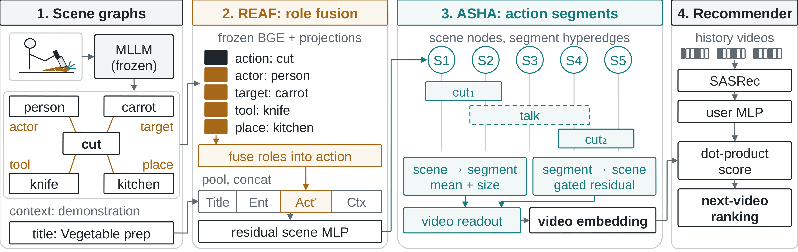

# ViewingContextPipeline

MicroLens-100K 영상 또는 M³L-10M 영화 예고편에서 관측 정보를 추출하고, **영문 제목에 영상 관측 정보와 표현 모듈을 더했을 때 추천 성능이 어떻게 달라지는지** 비교하는 실험 파이프라인입니다. 동일한 사용자·후보 아이템 목록(catalog)·분할에서 설정한 실험들을 독립적으로 학습하고 평가합니다.

## 프로젝트 소개와 전체 흐름



그림은 HGVRec의 전체 구조입니다. 논문의 Motivation·Framework 그림은 `python docs/design/generate_hgvrec_figures.py`로 재생성하며, 편집용 PPTX·벡터 PDF·600dpi PNG는 `WWW2027/figures/`에 저장합니다. 생성에는 `python-pptx`, `PyMuPDF`, LibreOffice가 필요합니다.

`preparation → extraction → validation` 순서로 처리합니다. 제목은 장면 추출에 넣지 않고 추천 인코더에서 결합합니다. **BGE 특징은 동결하고, 투영층·장면 인코더·선택 모듈·SASRec은 추천 loss로 함께 학습합니다.** 학습된 장면·영상 벡터는 추천 모델의 forward에서 계산합니다.

추천 실험은 `source + modules + readout`으로 정의합니다. metadata는 제목만, Description은 장면별 문단, Graph는 장면 내부의 Entity·Action·Context와 역할 연결을 사용합니다. 각 실험의 최종 영상·사용자 벡터는 512차원입니다.

## 추천 실험 구성

저장소 루트의 [rec_experiments_config.yaml](rec_experiments_config.yaml)을 편집합니다. 다음은 초기 구성의 예시이며, 실험 수와 이름은 이 목록으로 고정되지 않습니다.

```yaml
version: 1

defaults:
  readout: mean

experiments:
  - label: base
    source: metadata
    modules: []

  - label: description
    source: desc_qwen3vl
    modules: []

  - label: graph
    source: graph_qwen3vl
    modules: []

  - label: graph-activity
    source: graph_qwen3vl
    modules: [activity_hypergraph]

  - label: graph-role-activity
    source: graph_qwen3vl
    modules: [role_fusion, activity_hypergraph]
```

| 항목 | 설정 방법 |
| --- | --- |
| `version` | `1` |
| `defaults.readout` | 선택 항목. 생략하면 `mean`. 공통 `source`는 허용하지 않습니다. |
| `experiments[].label` | 필수 사용자 지정 이름. 소문자 영문으로 시작하고 영문 소문자·숫자·하이픈만 사용하며 중복은 허용하지 않습니다. 모델 구조를 결정하지 않습니다. |
| `experiments[].source` | 각 실험에 필수. `metadata`, `graph_qwen3vl`, `desc_qwen3vl`, `graph_gemini`, `desc_gemini` 중 선택합니다. |
| `experiments[].modules` | 생략하면 `[]`. Graph source에서 `role_fusion`, `activity_hypergraph`를 단독 또는 함께 사용할 수 있습니다. |
| `experiments[].readout` | 개별 값 → 공통값 → `mean` 순서로 적용합니다. 현재 `mean`만 지원합니다. |

제목은 모든 추천 실험에 포함하며 `use_title` 설정은 제공하지 않습니다. `metadata` 실험은 최대 하나이고, label에 관계없이 상대 성능 변화율의 기준이 됩니다. 없으면 상대 변화율을 생략합니다.

실험을 추가하려면 항목을 복사해 새 label과 source·modules를 적고, 삭제하려면 해당 항목을 제거합니다. Role Fusion만 비교하려면 Graph source에 `modules: [role_fusion]`을 지정합니다. 새로운 알고리즘은 코드 구현과 등록이 필요하며, 등록된 모듈의 조합은 YAML에서 변경합니다. 알 수 없는 설정·모듈, 중복 이름·모듈, 잘못된 조합과 빈 실험 목록은 실행 전에 거부합니다.

**모든 validation 명령은 이 파일의 전체 실험을 목록 순서로 처리합니다.** 일부만 실행하려면 파일의 목록을 해당 실험들로 구성합니다. `--target`, `--experiments`는 지원하지 않습니다. 설정은 명령 시작에 한 번 읽고 worker에도 같은 내용을 전달합니다. 실행 중 파일을 바꾸면 다음 명령부터 적용되므로 단계 사이에도 의도한 구성을 유지하세요.

## 실행 환경과 데이터 설정

저장소 루트에서 실행합니다. Ubuntu/Bash·Python 3.11 이상, 영상 준비를 위한 `ffmpeg`·`ffprobe`, 데이터와 로컬 모델 가중치가 필요합니다.

```bash
python -m pip install -e ".[train,embedding,dev]"
python -m pip check
```

Qwen 장면 추출 환경에는 `python -m pip install -e ".[qwen,dev]"`를 추가로 실행합니다. Linux/CUDA와 Qwen3-VL-2B-Instruct의 비양자화 BF16 checkpoint를 사용합니다. Gemini는 `python -m pip install -e ".[gemini,dev]"`로 설치하고 Vertex 프로젝트·위치·모델, ADC 인증·호출 권한을 설정합니다. 추출 환경과 임베딩·추천 환경은 분리할 수 있습니다.

| 설정 파일 | 역할 |
| --- | --- |
| [config.yaml](config.yaml) | 데이터·모델 경로, 추출·학습·평가·실행 자원 설정 |
| [rec_experiments_config.yaml](rec_experiments_config.yaml) | 비교할 추천 실험의 이름·입력 소스·모듈·집계 방식 |

`config.yaml`에서는 다음 항목을 확인합니다. 상대 경로는 저장소 루트 기준입니다.

| 설정 키 | 확인할 내용 |
| --- | --- |
| `datasets.<dataset>.data`, `datasets.<dataset>.source_counts` | 원본 데이터 경로와 검증할 개수 |
| `models.qwen3vl`, `models.bge`, `models.gemini` | 필요한 로컬 가중치 또는 Gemini 호출 설정 |
| `extraction.visual_evidence` | 시간 창·키프레임 수·해상도 |
| `extraction.qwen`, `extraction.gemini` | 추론 엔진·동시 실행 설정 |
| `extraction.{graph,description}.{qwen3vl,gemini}` | 장면 출력 토큰 한도 |
| `validation.cohort`, `validation.encoder` | 사용자 이력 처리와 BGE 인코딩 |
| `validation.model`, `validation.evaluation` | seed·학습·결정적 연산·평가·통계 설정 |
| `validation.graph_execution` | 특징 캐시·chunk·checkpoint 실행 설정 |
| `artifacts_root` | 산출물 상위 디렉터리 |

모든 명령에 `--dataset microlens_100k` 또는 `--dataset m3l_10m`을 지정합니다. 한 명령은 한 데이터셋만 처리하며, 같은 Run ID라도 데이터셋별 산출물과 캐시는 분리됩니다. 선택하지 않은 데이터셋의 원본 파일은 없어도 됩니다.

MicroLens는 interaction CSV·영상·제목을, M³L은 `data.root` 아래 MovieLens 평점·제목·ID 매핑과 원본 movie ID의 예고편을 사용합니다. M³L은 모든 평점을 상호작용으로 사용하고 미확보·손상 영상의 영화와 상호작용을 제외하므로 **평가한 영화 이력의 다음 영화 예측**으로 해석합니다. 입력 파일과 제외 정책은 [데이터 입력 규칙](docs/runtime.md#데이터-입력과-cohort)에 설명합니다.

## 단계별 실행

다음은 초기 Qwen source 구성을 처음 실행하는 예시입니다. 실행할 환경에서 설정과 필요한 원본·모델 경로를 먼저 확인합니다.

```bash
RUN_ID="experiment_001"
DATASET="microlens_100k"
```

### 1. 데이터와 키프레임 준비

```bash
python -m preparation prepare-cohort --run-id "$RUN_ID" --dataset "$DATASET"
python -m preparation prepare-input-data --run-id "$RUN_ID" --dataset "$DATASET"
```

`prepare-cohort`는 데이터·영상·제목을 점검하고 공유 cohort를 준비합니다. 영상 관측 source를 사용할 때 `prepare-input-data`로 키프레임을 준비합니다. metadata만 사용하는 실험에는 키프레임 준비와 장면 추출이 필요 없습니다.

### 2. 필요한 source 추출

YAML에서 사용하는 서로 다른 시각 source만 준비합니다. 추출 명령의 `--arm`은 source 식별자이며 추천 실험의 label과 구분합니다.

```bash
python -m extraction extract-graph-scenes --run-id "$RUN_ID" --dataset "$DATASET" --schema prompts/scene_graph_v9.md --model qwen3vl --arm graph_qwen3vl
python -m extraction extract-description-scenes --run-id "$RUN_ID" --dataset "$DATASET" --schema prompts/scene_description_v3.md --model qwen3vl --arm desc_qwen3vl
```

| YAML source | 추출 명령 | `--model` | `--arm` |
| --- | --- | --- | --- |
| `metadata` | 필요 없음 | — | — |
| `graph_qwen3vl` | `extract-graph-scenes` | `qwen3vl` | `graph_qwen3vl` |
| `desc_qwen3vl` | `extract-description-scenes` | `qwen3vl` | `desc_qwen3vl` |
| `graph_gemini` | `extract-graph-scenes` | `gemini` | `graph_gemini` |
| `desc_gemini` | `extract-description-scenes` | `gemini` | `desc_gemini` |

Gemini도 표의 model·source로 추출하고 YAML의 `source`에 같은 값을 명시하면 추천에 연결됩니다. Graph·Description의 `--schema`는 각각 위 프롬프트를 지정합니다. 생성 옵션과 출력 예시는 [장면 추출](docs/scene_extraction.md)을 참고하세요.

장면 결과는 `<artifacts_root>/runs/<RUN_ID>/<dataset>/extraction/<source>/`에 저장합니다. 기존 `extraction/scenes/<source>/` 결과를 재사용하려면 source 폴더 전체를 새 위치로 옮깁니다.

### 3. 고정 특징과 활동 구간 준비

```bash
python -m validation embed-representations --run-id "$RUN_ID" --dataset "$DATASET"
python -m validation prepare-module --run-id "$RUN_ID" --dataset "$DATASET"
```

특징은 같은 source에 대해 한 번 준비합니다. `prepare-module`은 `activity_hypergraph`를 사용하는 Graph source의 활동 구간만 준비하고, 해당 모듈이 없으면 정상 종료합니다. 활동 구간 준비는 VLM·BGE를 다시 실행하지 않습니다.

### 4. 추천 학습과 결과 진단

```bash
python -m validation run-recommendation --run-id "$RUN_ID" --dataset "$DATASET" --workers-per-gpu 1
python -m validation run-diagnosis --run-id "$RUN_ID" --dataset "$DATASET"
```

각 명령은 독립 단계입니다. 앞 단계의 성공을 확인한 뒤 다음 명령을 실행하세요. 추천 명령은 특징·활동 구간 준비나 진단을 자동 실행하지 않습니다.

`run-diagnosis`는 실험 설정 도입 직전의 v4 결과(`base, d, g0, g1, g2`)도 읽습니다. 현재 선택한 구성과 동일한 예전 Arm 폴더가 모든 설정 seed에 있으면 기존 이름으로 진단·보고서를 생성하며, 원본 recommendation 파일은 변경하지 않습니다. 새 이름과 예전 이름의 폴더가 함께 있으면 모호한 선택을 막기 위해 중단합니다. 예전 파일에 없는 `experiment_definition`만 검증된 `experiment_arm`에서 복원하며, 구조·입력·평가 계약·체크섬 검증은 유지합니다. 더 오래된 구조나 변경된 입력을 자동으로 호환 처리하지 않으며, 이 처리는 추천 학습 재개나 Run 간 비교에는 적용하지 않습니다.

GPU는 `CUDA_VISIBLE_DEVICES`로 선택합니다. Qwen은 GPU별 추론 엔진을, 추천은 `--workers-per-gpu`개 독립 학습 작업을 실행합니다. 추천은 보이는 GPU가 없으면 worker 수 1에서 CPU로 실행할 수 있습니다. 시작 로그에는 실험 설정 파일·해석된 구성·`deterministic` 적용값을 표시합니다.

## 결과 확인과 해석

`<run-root>`는 `<artifacts_root>/runs/<RUN_ID>/<dataset>/`입니다. `<experiment-set>`은 YAML의 label을 순서대로 밑줄로 연결한 이름입니다.

| 확인할 내용 | `<run-root>` 아래 위치 |
| --- | --- |
| 실험별 checkpoint·학습 기록·이벤트 지표·영상 벡터 | `validation/recommendations/seed_<seed>/<label>/` |
| 최종 지표·실험 정의·통계·검증 판정 | `validation/diagnosis/<experiment-set>/diagnosis.json` |
| 사람이 읽는 진단 보고서 | `reports/<experiment-set>/report.md` |
| 실제 입력·분할·고정 특징의 근거 | `validation/cohort/`, `validation/representations/<source>/` |

최종 test 점수는 진단의 `recommendations.means`에서 확인합니다. seed별 값과 표본 표준편차, metadata 기준 상대 변화율, source·modules·readout과 파라미터 수도 보고합니다. `training.json`의 epoch별 validation HR@10은 최종 test 점수와 구분합니다.

사용자별 마지막 두 상호작용을 validation/test로 보류하고, validation HR@10으로 checkpoint를 선택한 뒤 test를 한 번 평가합니다. NDCG@10은 사용자별 seed 평균에 paired bootstrap을 적용하며 설정된 모든 실험 쌍에 Bonferroni 보정합니다. HR@10은 기술통계입니다. 실험이 N개이고 seed가 S개이면 SN개 학습·N(N−1)/2쌍 비교를 수행합니다. 위 초기 예시는 3개 seed에서 15개 학습·10쌍 비교입니다.

보고서의 비교는 기록된 구성 전체의 차이입니다. source·인코딩·장면 확보율·파라미터 수가 함께 달라지면 개별 모듈만의 효과로 단정할 수 없습니다. `runtime_decision.status: pass`는 실행 증거의 검증 통과이며 추천 성능 향상 판정이 아닙니다. 통계와 모델 해석은 [학습·평가](docs/graph_training.md#평가와-결과-해석)를 참고하세요.

동일한 실험 정의·사용자·이벤트·catalog·분할·seed·평가 계약의 Run은 진단 명령에 `--compare-run-id <reference-run-id>`를 추가해 비교할 수 있습니다.

## 재실행과 재현성

| 상황 | 처리 |
| --- | --- |
| 정상 장면 | 생성 설정을 바꾸어도 재사용 |
| 누락·실패·Graph warning 장면 | 같은 추출 명령에서 현재 설정으로 한 번씩 재시도 |
| 완료된 추천 조합 | 입력·실험 정의·학습·평가 조건을 검증한 뒤 재사용 |
| 미완료 추천 조합 | 처음부터 다시 학습. epoch 중간 재개는 지원하지 않음 |
| 다른 실험 추가·삭제 | 정의가 같은 기존 실험과 공통 source 특징은 재사용 가능 |
| 같은 label의 구성 변경 | 기존 결과와 충돌하면 새 Run ID 필요. `--force`로 우회 불가 |

추출의 `--force`는 해당 source의 정상 결과까지 재생성합니다. 특징·추천의 `--force`는 캐시 읽기를 우회하므로 결과를 보존하려면 새 Run ID를 사용하세요. label 변경은 저장 경로·결과 식별도 바꾸며 기존 결과를 새 이름으로 자동 변환하지 않습니다. 단계별 규칙은 [저장·재사용 계약](docs/runtime.md#재실행과-캐시)을 참고하세요.

`validation.model.deterministic: true`는 각 실험·seed의 난수 초기화와 PyTorch 결정적 연산을 적용합니다. 같은 입력·seed·환경에서 반복 실행의 수치 변동을 줄이지만 서로 다른 seed나 하드웨어·라이브러리 버전 간 동일 결과까지 보장하지 않습니다. 기준 모델과 모듈 추가 모델은 같은 설정으로 비교하고 여러 seed를 유지합니다. 재사용된 결과의 일치는 재학습 반복 검증과 구분해야 합니다.

## 모델 구조 요약과 상세 문서

| 입력·선택 모듈 | 추천 모델에서의 역할 |
| --- | --- |
| metadata | 제목 특징 → 투영·Residual MLP → 영상 벡터 |
| Description | 제목·장면 문단 특징 → 투영·Residual Scene MLP → 장면 평균 |
| Graph | 제목·Entity·Action·Context 특징 → 투영·장면 내부 평균 → Residual Scene MLP |
| `role_fusion` | Scene MLP 앞에서 역할별 Entity를 Action에 결합 |
| `activity_hypergraph` | Scene MLP 뒤에서 장면–활동 구간 전달과 구간 기여를 적용 |
| 공통 추천기 | 이력 영상 벡터 → SASRec·User MLP → 후보 영상 벡터와 내적 |

모듈 목록 순서와 무관하게 역할 결합 → Scene MLP → 활동 Hypergraph → 영상 집계 순서로 적용합니다. 장면 내부 Entity ID는 영상 간 공유 노드가 아니며, 장면 간 동일 개체 추적이나 명시적 사건 관계는 구현하지 않습니다. SASRec의 사용자 시청 순서와 영상 내부 장면 관계는 구분합니다.

| 상세 문서 | 내용 |
| --- | --- |
| [장면 추출](docs/scene_extraction.md) | 장면·스키마·출력 예시·파싱 한계·Qwen/Gemini 옵션 |
| [인코더·모듈·학습·평가](docs/graph_training.md) | 수식·초기 구성 그림·결측 처리·평가 규칙·설계 배경 |
| [실행·저장 계약](docs/runtime.md) | 데이터 입력·산출물·캐시·재시도·마이그레이션 |
| [프로젝트 이정표](docs/TODO.md) | 구현 상태와 실험·후속 검토 기록 |
| [프롬프트 변경 이력](prompts/update_note.md) | 프롬프트 버전과 변경 의도 |

CPU·오프라인 검증은 `python -m pytest -q tests`로 실행합니다. 이는 수식·저장·작은 데이터 실행 경로의 회귀 검사이며, 실제 관측의 시각적 정확도·CUDA 처리량·전체 데이터 성능 우위는 별도 검증이 필요합니다.
