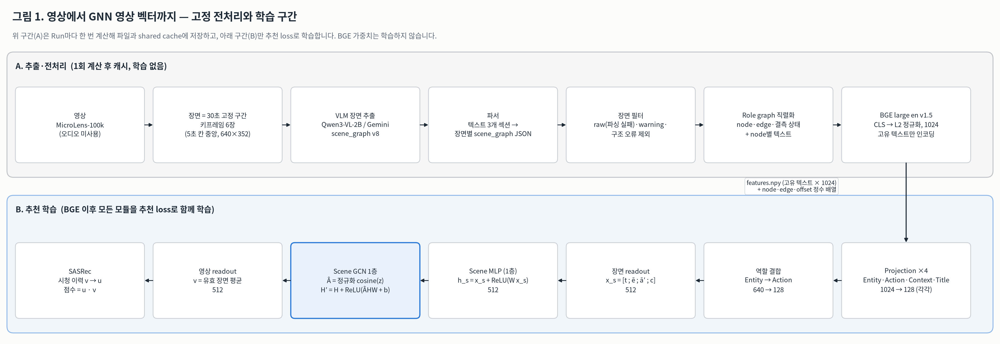
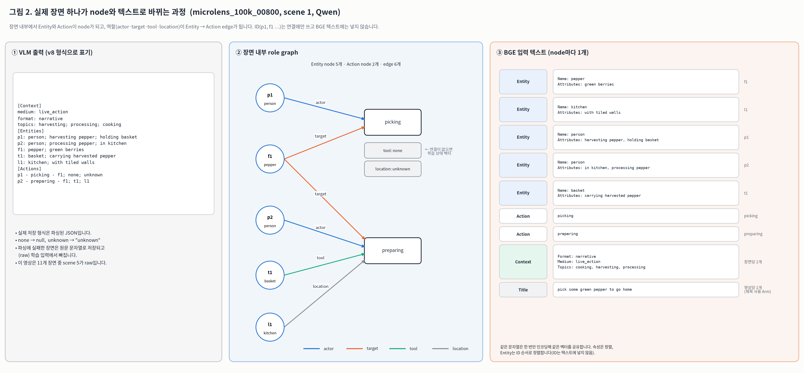
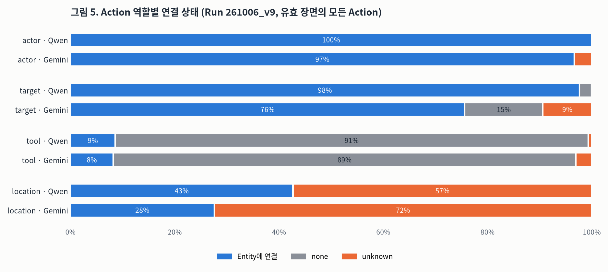
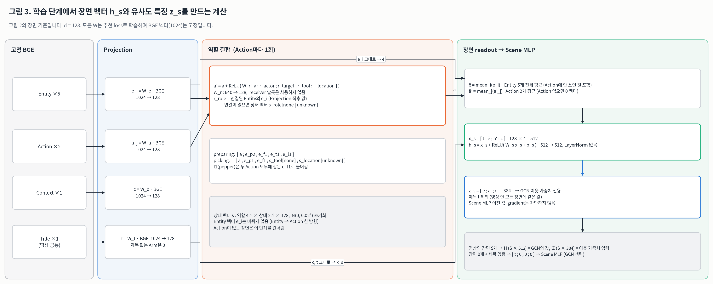
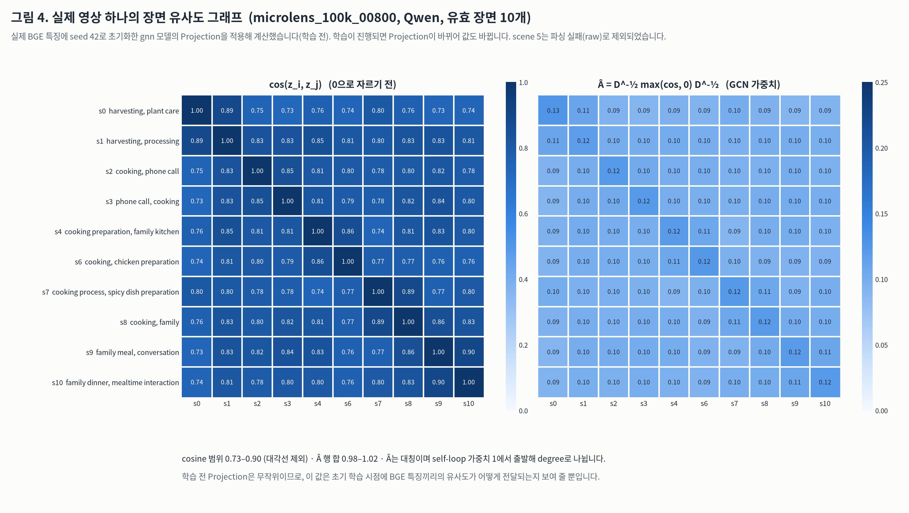

# 기존 GNN(`gnn`) 모델: node와 feature를 만드는 과정

- **기준 코드**: `kihoon` 브랜치 `4753cd3`. 해당 파일은 `src/visual_sampling.py`, `src/extraction/structured_output.py`, `src/validation/graph_inputs.py`, `graph_batching.py`, `graph_model.py`, `scene_gcn.py`입니다.
- **계약 버전**: 모델 `sasrec-role-graph/v10`, 입력 `role-graph-inputs/v4`
- **실데이터**: Run `261006_v9`의 추출 결과와 이미 준비된 graph 입력 묶음입니다.

이 문서의 숫자는 **입력 데이터 통계**와 **학습 전 초기 상태**를 직접 계산한 값입니다. 추천 학습이나 평가는 하지 않았습니다. 그림 생성 코드와 통계 원본은 문서 끝의 [재생성](#재생성) 절에 있습니다.

## 요약

- **장면**은 영상을 30초씩 자른 고정 구간입니다. VLM(Qwen3-VL-2B 또는 Gemini)이 장면마다 `[Context]`·`[Entities]`·`[Actions]`를 텍스트로 출력하고, 이를 파싱해 JSON으로 저장합니다.
- 모델 안에는 **두 단계의 그래프**가 있습니다.
  - **장면 내부 role graph**: Entity와 Action이 node, 역할(actor·target·tool·location)이 edge입니다. 정보는 Entity → Action 방향으로 **한 번만** 모읍니다(역할 결합).
  - **영상 내부 scene graph**: 한 영상의 유효 장면들이 node이고, 모든 장면 쌍이 연결됩니다. 여기서 **GCN 1층**이 메시지를 전달합니다.
- 모든 node 텍스트는 **고정 BGE**(bge-large-en-v1.5)로 한 번 인코딩해 1024차원으로 캐시합니다. 학습은 그 뒤 Projection부터 시작합니다.
- 장면 벡터는 `h_s = SceneMLP([제목; Entity 평균; Action 평균; Context])`(512)입니다. GCN의 이웃 가중치는 제목을 뺀 `z_s`(384)의 cosine으로 정합니다.
- **실데이터 관찰**: 학습 전 초기 상태에서는 같은 영상 장면들의 `z` cosine이 평균 0.82로 높습니다. 그래서 GCN 가중치 `Â`가 거의 균등합니다(행 정규화 엔트로피 0.997). 초기 gnn은 사실상 "영상 안 장면을 거의 같은 비중으로 섞는" 연산에 가깝습니다. 학습 후 이 값이 어떻게 바뀌는지는 측정하지 않았습니다.

## 1. 전체 흐름



| 구간 | 하는 일 | 저장 위치 (Run 기준) | 학습 여부 |
|---|---|---|---|
| A. 추출 | 장면 분할 → VLM → 파서 | `extraction/scenes/<graph_qwen\|graph_gemini>/<content_id>.jsonl` | 없음 |
| A. 입력 준비 | 장면 필터 → node·edge 배열 → BGE | `validation/representations/graph/<arm>_embeddings/` + shared cache | 없음 |
| B. 추천 학습 | Projection → 역할 결합 → Scene MLP → GCN → 평균 → SASRec | `validation/recommendations/graph/gnn/…` | 전부 학습 |

Arm은 장면 출처와 제목 사용 여부의 조합입니다.

| Arm | 장면 출처 | 제목 |
|---|---|---|
| `graph_qwen` | Qwen | 사용 안 함 |
| `graph_qwen_meta` | Qwen | 사용 |
| `graph_gemini_meta` | Gemini | 사용 |
| `meta` | 없음 (제목만 쓰는 SASRec, GCN 없음) | 사용 |

## 2. 장면과 VLM 출력

**장면 분할** (`build_fixed_windows`)

- 영상을 `[0, 30)`, `[30, 60)`, … 의 30초 구간으로 나눕니다. 마지막 구간은 영상 끝에서 자릅니다.
- 구간을 5초 칸 6개로 나누고, 각 칸의 중앙(2.5초, 7.5초, …, 27.5초)에서 키프레임을 뽑습니다. 해상도는 640×352이고 오디오는 쓰지 않습니다.

**VLM 출력** (프롬프트 [scene_graph v8](../../prompts/scene_graph_v8.md))

- Run `261006_v9`의 추출 실패 기록(`failures/`) provenance에 Qwen·Gemini 모두 `prompts/scene_graph_v8.md`, 스키마 계약 `graph/v5`가 기록되어 있습니다. 정상 장면 행에는 provenance가 없지만, receiver 없는 5개 필드 형식이라 같은 프롬프트로 판단했습니다.
- 장면마다 세 섹션을 텍스트로 출력합니다.
  - `[Context]`: medium, format, 최대 3개의 topics
  - `[Entities]`: `id: kind; attribute; attribute`
  - `[Actions]`: `actor - action - target; tool; location`
- 역할 값은 선언된 Entity ID, `none`(역할이 없음), `unknown`(있지만 식별 불가) 중 하나입니다.
- 프롬프트의 개수 상한(Entity 6개, Action 4개, 속성 2개 등)은 **지시일 뿐 검증하지 않습니다**. 실제로 Qwen 장면에는 Entity가 최대 25개까지 있습니다(아래 표).

**파싱과 저장**

- 파서는 텍스트를 `scene_graph` JSON으로 바꿉니다. 이때 `none`은 `null`, `unknown`은 문자열 `"unknown"`이 됩니다.
- 영상마다 JSONL 파일 1개를 쓰고, 장면마다 `content_id`, `scene_idx`, `tokens`, `warning`, `scene_graph` 필드를 가진 1행을 저장합니다.

## 3. 학습에 쓸 장면 고르기

`build_input`은 장면을 `scene_idx` 순서로 읽고, 다음 순서로 검사해 제외합니다.

1. **raw**: `scene_graph`가 JSON이 아니라 문자열인 장면입니다(파싱 실패 원문). 예를 들어 `microlens_100k_00800`의 scene 5는 두 Action을 한 줄에 써서 `INVALID_ACTION_SYNTAX`로 파싱에 실패했고 raw로 저장되었습니다.
2. **warning**: `warning` 태그가 있는 장면입니다.
3. **invalid_structure**: 다음 구조 검사(`validate_graph_structure`)에 실패한 장면입니다.
   - 스키마
   - Entity ID 형식·중복
   - Action마다 선언된 actor 또는 target이 필요
   - 선언되지 않은 ID 참조
   - 모호한 Action 문구

Run `261006_v9`의 결과는 다음과 같습니다.

| 항목 | Qwen | Gemini |
|---|---:|---:|
| catalog 영상 | 19,671 | 19,671 |
| 전체 장면 | 115,461 | 115,481 |
| 유효 장면 | 105,089 (91.0%) | 114,172 (98.9%) |
| raw로 제외 | 10,372 (9.0%) | 1,309 (1.1%) |
| warning·구조 오류로 제외 | 0 | 0 |
| 장면 파일 없음 | 1 | 0 |
| 유효 장면 0개 영상 | 136 | 25 |
| 유효 장면 1개 영상 | 2,230 | 2,117 |
| 영상당 유효 장면 (중앙값 / 평균 / 최대) | 5 / 5.34 / 56 | 5 / 5.80 / 58 |
| 장면당 Entity (평균 / 최대) | 4.37 / 25 | 3.84 / 10 |
| 장면당 Action (평균 / 최대) | 2.04 / 18 | 2.04 / 5 |
| Action 없는 유효 장면 | 47 | 8,819 (7.7%) |

이 Run에서는 warning이 붙은 장면이 모두 파싱 실패 원문이었습니다. 그래서 raw 검사에서 먼저 제외되었고, warning으로 집계된 장면이 0입니다.

## 4. Node와 edge 만들기



### 규칙

| 대상 | node 수 | BGE에 들어가는 텍스트 |
|---|---|---|
| Entity | 장면 안 Entity마다 1개 (ID 순 정렬) | `Name: {kind}\nAttributes: {속성을 정렬해 쉼표로 연결}` |
| Action | 장면 안 Action마다 1개 | Action 문구만 (예: `preparing`). 역할 정보는 텍스트에 넣지 않음 |
| Context | 장면마다 1개 (graph node 아님) | `Format: …\nMedium: …\nTopics: {정렬, 쉼표}` |
| Title | 영상마다 1개 (graph node 아님) | 메타데이터 제목. 제목을 쓰지 않는 Arm은 0번(빈 문자열) |

- **ID는 연결에만 씁니다.** `p1`, `f1` 같은 ID는 텍스트에 들어가지 않습니다.
- **node는 장면 안에서만 유효합니다.** 장면마다 ID 조회표를 새로 만들기 때문에, 다른 장면의 같은 `p1`은 다른 node입니다. 장면 사이나 영상 사이에 Entity를 이어 주는 edge는 없습니다.
- **같은 텍스트는 같은 BGE 벡터를 공유합니다.** 텍스트 단위로 중복을 제거하므로, 다른 장면에 있는 `Name: person\nAttributes: wearing apron`은 node는 다르지만 같은 특징 행을 가리킵니다.
- **edge**: Action의 역할(actor·target·tool·location)이 Entity ID를 가리키면 `[Entity, Action, 역할]` 정방향 edge와 `[Action, Entity, 역할 + 5]` 역방향 edge를 저장합니다. **현재 모델은 정방향(0, 1, 2, 4)만 읽습니다.**
- **결측 상태**: Action마다 `[Action node, actor, target, tool, receiver, location]` 한 행을 저장합니다. 값은 `−1` = Entity에 연결, `0` = none, `1` = unknown입니다. receiver는 v8 프롬프트에서 제거되었습니다. 형태 호환을 위해 슬롯만 남아 있고 항상 `0`입니다.

### 실제 배열 예시

아래는 그림 2의 장면 하나만 실제 `build_input`에 넣었을 때 나온 배열입니다(제목 사용 Arm 기준). 실제 묶음에서는 node 번호가 catalog 전체 기준으로 이어집니다.

```text
texts (features 행)  0 ''                      ← 항상 0 벡터 (padding·제목 없음)
                     1 'pick some green pepper to go home'          (Title)
                     2 'Name: pepper\nAttributes: green berries'     (f1)
                     3 'Name: kitchen\nAttributes: with tiled walls' (l1)
                     4 'Name: person\nAttributes: harvesting pepper, holding basket' (p1)
                     5 'Name: person\nAttributes: in kitchen, processing pepper'     (p2)
                     6 'Name: basket\nAttributes: carrying harvested pepper'         (t1)
                     7 'picking'   8 'preparing'
                     9 'Format: narrative\nMedium: live_action\nTopics: cooking, harvesting, processing'
nodes      [2, 3, 4, 5, 6, 7, 8]      node 0–4 = f1 l1 p1 p2 t1,  5 = picking,  6 = preparing
types      [0, 0, 0, 0, 0, 1, 1]      0 Entity, 1 Action
contexts   [9]          titles [1]
edges      [2,5,0] [0,5,1]                     p1→picking actor, f1→picking target
           [3,6,0] [0,6,1] [4,6,2] [1,6,4]     p2·f1·t1·l1 → preparing (actor·target·tool·location)
           (+ 각 edge의 역방향, 역할 5–9)
missing    [5, -1, -1,  0, 0,  1]               picking:   tool none, location unknown
           [6, -1, -1, -1, 0, -1]               preparing: 네 역할 모두 연결
scene_offsets [0, 7]   edge_offsets [0, 12]   missing_offsets [0, 2]   video_offsets [0, 1]
```

| 배열 | 모양 | 의미 |
|---|---|---|
| `features.npy` | (고유 텍스트 수, 1024) float32 | BGE 벡터. 0행은 0 벡터 |
| `nodes`, `types` | (node 수,) | node → 특징 행, node 종류 |
| `scene_offsets` / `video_offsets` | (장면 수 + 1,) / (영상 수 + 1,) | 장면별 node 범위 / 영상별 장면 범위 |
| `contexts` | (장면 수,) | 장면 → Context 특징 행 |
| `edges`, `edge_offsets` | (edge 수, 3), (장면 수 + 1,) | `[보내는 node, 받는 node, 역할]`, 장면별 범위 |
| `missing`, `missing_offsets` | (Action 수, 6), (장면 수 + 1,) | 역할별 연결 상태, 장면별 범위 |
| `titles` | (영상 수,) | 영상 → 제목 특징 행 (0 = 없음) |

### 실데이터의 역할 연결 상태



- actor는 거의 항상 Entity에 연결됩니다.
- tool은 약 90%가 none입니다.
- location은 Qwen 57%, Gemini 72%가 unknown입니다.
- Gemini는 target이 none·unknown인 비율이 24%로, Qwen(2.4%)보다 훨씬 높습니다.

연결되지 않은 역할은 학습되는 상태 벡터로 채워집니다(5절). 따라서 tool·location 자리에는 실제 Entity보다 상태 벡터가 들어가는 경우가 더 많습니다.

## 5. BGE 특징 (고정)

- **모델·출력**: `bge-large-en-v1.5`(로컬)의 CLS 토큰 출력을 L2 정규화해 1024차원으로 씁니다. `max_length` 512(넘으면 잘라내고 개수를 기록), batch 32이며, 질의용 instruction prefix는 붙이지 않습니다. BGE 가중치는 학습하지 않습니다.
- **인코딩 범위**: `embed-representations` 한 번에 준비하는 모든 Arm의 고유 텍스트를 모아 한 번만 인코딩합니다. GPU가 여러 개면 GPU마다 독립 복제본으로 나눠 계산합니다.
- **중복 제거 효과**: Qwen 제목 사용 묶음은 텍스트 참조 798,694개(node + Context + Title)가 특징 행 346,455개(0행 포함)로 줄었습니다. Gemini는 804,756개 → 422,408개입니다.
- **캐시 재사용**: 캐시 키는 장면 파일 checksum, catalog, 제목, encoder 설정, BGE 모델 identity, 입력 버전을 합친 hash입니다. 키가 같으면 shared cache를 재사용하고, aggregation(`mean`/`gnn`/attention 계열)이 달라도 같은 묶음을 씁니다.

## 6. 학습 단계: 장면 벡터 `h_s`와 유사도 특징 `z_s`



d = 128, 장면 벡터 = 4d = 512입니다.

```text
e_i = W_e · BGE(Entity_i)        a_j = W_a · BGE(Action_j)        (1024 → 128, 각각 별도 W)
c   = W_c · BGE(Context)         t   = W_t · BGE(Title)  (제목 없는 Arm은 0)

역할 결합 (Action마다 1회)
a′_j = a_j + ReLU( W_r [ a_j ; r_actor ; r_target ; r_tool ; r_location ] )     640 → 128
       r_role = 연결된 Entity의 e_i,  연결 없음 → 상태 벡터 s_role[none | unknown]

장면 readout
ē = mean_i e_i  (장면의 모든 Entity)      ā′ = mean_j a′_j  (Action 없으면 0)
x_s = [ t ; ē ; ā′ ; c ]  (512)          h_s = x_s + ReLU( W_s x_s + b_s )   (512 → 512)
z_s = [ ē ; ā′ ; c ]      (384, 제목 제외, Scene MLP 이전)
```

| 모듈 | 파라미터 수 |
|---|---:|
| Projection 4개 (Title·Entity·Action·Context) | 131,200 × 4 |
| 역할 결합 `W_r` | 82,048 |
| 상태 벡터 `s` (역할 4 × 상태 2 × 128) | 1,024 |
| Scene MLP | 262,656 |
| Scene GCN `W` | 262,656 |
| **영상 인코더 합계** | **1,133,184** |

- 역할 결합은 Entity → Action **한 방향, 한 번**입니다. Entity 벡터 `e_i`는 바뀌지 않고, Action끼리나 Entity끼리 직접 주고받는 연산도 없습니다.
- `ē`는 Action에 쓰이지 않은 Entity까지 포함한 단순 평균입니다.
- 제목 `t`는 같은 영상의 모든 장면에 같은 값으로 들어갑니다. 그래서 장면을 구분하는 GCN 유사도 입력 `z_s`에서는 뺍니다.
- LayerNorm은 Projection·Scene MLP·GCN 어디에도 없습니다. 상태 벡터는 `N(0, 0.02²)`, Linear는 xavier normal·bias 0으로 초기화합니다.

## 7. 영상 내부 Scene GCN



**계산** (영상 하나 단위)

```text
A_ij = max( cos(z_i, z_j), 0 ),   A_ii = 1
    = D^-½ A D^-½,   D_ii = Σ_j A_ij            (대칭, 행 합은 정확히 1이 아님)
H′   = H + ReLU( Â H W + b )                     (W 512 × 512, 1층)
v    = (1/S) Σ_s H′_s                            (유효 장면 평균 → 영상 벡터 512)
```

- **연결 범위**: node는 한 영상의 유효 장면뿐이고, 모든 장면 쌍이 연결됩니다(self-loop 포함). 다른 영상과의 edge와 시간 순서 정보는 없습니다.
- **묶음 계산**: 장면 수가 같은 영상끼리 `(영상 수, S, ·)` 텐서로 묶어 padding 없이 계산합니다.
- **학습 중 재계산**: `Â`는 forward마다 다시 계산합니다. `z`가 학습되는 Projection의 출력이므로 `Â`도 학습 중에 바뀌고, gradient도 `z`로 흐릅니다.
- **예외 경로**
  - 장면 1개: `Â = [1]`
  - 유효 장면 0개 + 제목 있음: `[t ; 0 ; 0 ; 0]` → Scene MLP (GCN 생략)
  - 제목도 장면도 없음: 0 벡터

**초기 상태 실측 결과** (seed 42 초기화, 학습 전)

| 항목 | Qwen | Gemini |
|---|---:|---:|
| 장면 2개 이상 영상 | 17,305 | 17,529 |
| 같은 영상 장면 쌍 cos(z) 평균 (10% / 50% / 90%) | 0.816 (0.76 / 0.81 / 0.88) | 0.824 (0.75 / 0.83 / 0.89) |
| 다른 영상 장면 쌍 cos(z) 평균 (무작위 약 20만 쌍) | 0.727 | 0.716 |
| `Â` 행 정규화 엔트로피 평균 (1 = 균등) | 0.997 | 0.997 |
| `Â` 행 최대 가중치 × S 평균 (1 = 균등) | 1.19 | 1.18 |
| 서로 다른 BGE 텍스트 무작위 쌍 cosine (Entity / Action / Context) | 0.61 / 0.55 / 0.75 | 0.59 / 0.56 / 0.74 |

엔트로피는 각 `Â` 행을 합 1로 다시 정규화해서 계산했습니다.

- **관찰**: 무관한 텍스트끼리도 BGE cosine이 0.55–0.75로 높습니다. 그 위에서 Entity·Action을 평균하므로 장면 특징 `z`끼리의 cosine이 전반적으로 높아집니다. 같은 영상 장면 쌍(0.82)이 다른 영상 장면 쌍(0.72)보다 높기는 하지만, `max(cos, 0)` 뒤 degree 정규화를 거치면 차이가 거의 남지 않습니다. 그림 4의 영상에서도 cosine은 0.73–0.90, `Â`는 0.09–0.13이었습니다.
- **해석 (미검증 가설)**: 학습 시작 시점의 gnn은 내용이 비슷한 장면을 골라 섞기보다, 영상 안의 장면을 거의 같은 비중으로 섞는 쪽에 가깝습니다. 학습 중에 Projection이 바뀌면서 구조가 뚜렷해지는지는 학습된 checkpoint로 같은 통계를 다시 내 봐야 알 수 있습니다.

## 8. SASRec과의 연결

- **영상 벡터의 사용**: 영상 벡터 `v`(512)를 SASRec의 item 벡터로 **그대로** 씁니다(별도 item MLP 없음). 시청 이력의 영상과 점수를 매길 후보 영상 모두 같은 인코더를 거칩니다.
- **사용자 벡터와 점수**
  - 최근 시청 영상 최대 10개의 `v`에 위치 임베딩을 더해 SASRec(2 blocks, 2 heads, causal)에 넣습니다.
  - 출력 LayerNorm 뒤 마지막 유효 위치를 User Residual MLP(LayerNorm·GELU)에 통과시켜 `u`를 만듭니다.
  - 점수는 `u · v`입니다.
- **계산 범위**: 학습 batch마다 등장하는 고유 영상만 인코딩합니다. 메모리가 부족하면 chunk와 checkpoint로 나눠 계산하며, 결과 값은 같습니다.
- **학습 설정**: AdamW lr 1e-4, batch 128, leave-one-out, validation HR@10 기준 checkpoint 선택 등은 [graph_training.md](../graph_training.md)에 있습니다.

## 9. 구조상 특징 정리

| 항목 | 현재 구현 |
|---|---|
| 그래프 단계 | 장면 내부 role graph(Entity→Action 1회 모으기) + 영상 내부 scene graph(GCN 1층) |
| 정보 방향 | Entity → Action만. 역방향 edge는 저장만 하고 사용하지 않음 |
| node 범위 | 장면 내부만. 장면·영상 사이 Entity 연결 없음 |
| Action 텍스트 | 동작 문구만. 누가 무엇에 했는지는 역할 결합으로만 반영 |
| 제목 | 모든 장면의 `x_s`에 같은 값으로 포함, GCN 유사도 입력에서는 제외 |
| 장면 순서 | 사용하지 않음 (장면 순서를 바꿔도 영상 벡터가 같음) |
| receiver | 슬롯만 남아 있고 항상 none |
| 프롬프트 개수 상한 | 지시일 뿐 검증하지 않음 (Qwen 장면당 Entity 최대 25) |

## 해석할 때 주의할 점

- 이 문서의 수치는 Run `261006_v9`의 입력 통계와 **학습 전** 초기 상태입니다. 다른 Run이나 학습 후 모델에서는 다를 수 있습니다.
- 그림 4와 7절 통계는 seed 42 하나로 초기화한 결과입니다.
- 추천 성능(HR·NDCG)과는 직접 관련이 없으며, gnn과 mean의 성능 차이는 이 문서로 판단할 수 없습니다.

## 재생성

```bash
# matplotlib가 필요합니다. Run의 embed-representations가 끝나 있어야 합니다.
PYTHONPATH=src python docs/design/generate_gnn_inputs_report.py --run-root /mnt/microlens/artifacts/runs/261006_v9
```

스크립트는 이 디렉터리에 그림 5장(`gnn_inputs_*.png`)과 통계 원본 [gnn_inputs_statistics.json](gnn_inputs_statistics.json)을 다시 씁니다. 모델 학습은 하지 않습니다. 그림 4와 7절 통계는 CPU에서 catalog 전체를 한 번 인코딩해 계산합니다(이 PC에서 수 초).
