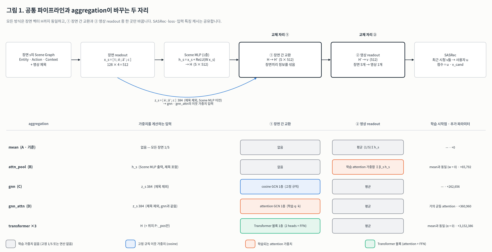
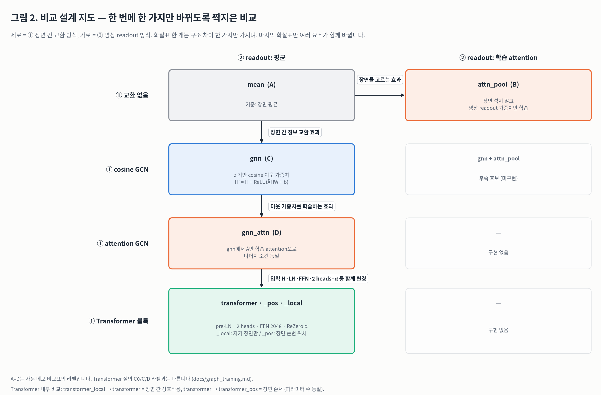
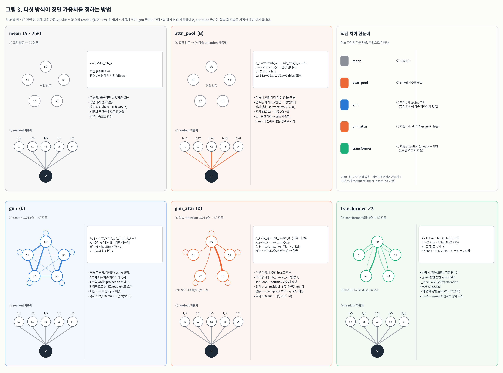
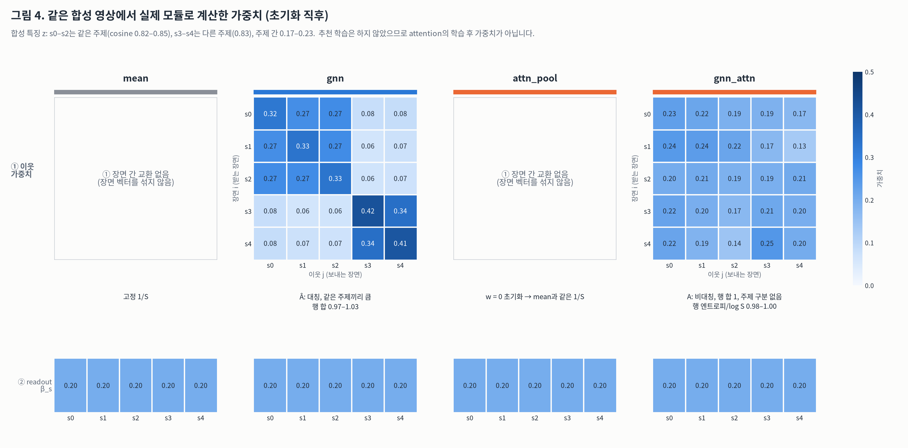
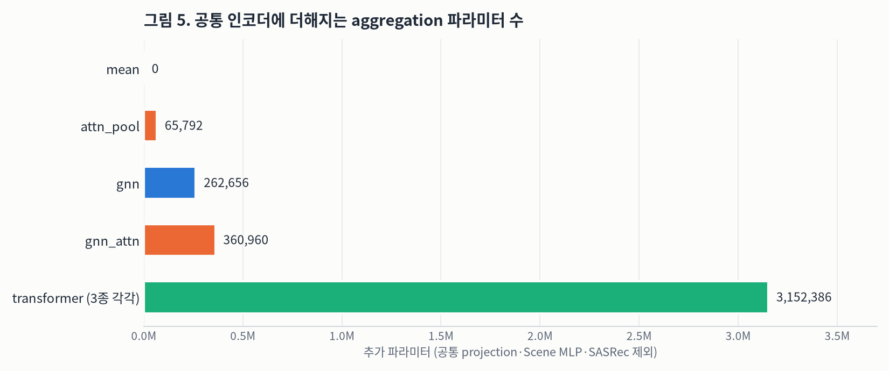

# 장면 aggregation 비교: mean · gnn · attention

기준 코드: `kihoon` 브랜치 `4753cd3`. 대상은 `src/validation/graph_model.py`, `scene_gcn.py`, `scene_attention.py`, `scene_transformer.py`, `graph_context.py`입니다.

이 문서는 **구조 비교**만 다룹니다. `attn_pool`·`gnn_attn`·Transformer 3종은 추천 학습·평가를 아직 실행하지 않아 성능 비교는 없습니다. 그림 4의 숫자만 실제 모듈로 계산한 값입니다(합성 입력, 초기화 직후).

## 요약

- 모든 방식은 장면 벡터 `H`(S × 512)까지 같습니다. 바뀌는 곳은 **① 장면 간 교환**과 **② 영상 readout** 두 자리 중 하나뿐입니다.
- **mean**: 교환이 없고, 모든 장면을 `1/S`로 평균합니다. 학습하는 가중치가 없습니다.
- **gnn**: ①에 cosine 규칙 GCN을 넣습니다. 이웃 가중치 `Â`는 정해진 공식(non-negative cosine + 대칭 정규화)이라 `Â` 자체에는 학습 파라미터가 없습니다.
- **attn_pool** (추가): ②만 바꿔서 장면마다 점수를 학습하고 softmax 가중합을 합니다. 장면끼리는 섞지 않습니다. 시작할 때는 mean과 **정확히 같은 함수**입니다.
- **gnn_attn** (추가): gnn에서 이웃 가중치만 학습 `q·k` attention(행 softmax)으로 바꿉니다. 나머지 조건은 gnn과 같습니다. 초기 상태는 gnn과 다르며, 주제 구조가 없는 거의 균등한 attention에서 출발합니다.
- **transformer ×3** (attention 계열 참고): ①에 pre-LN Transformer 블록을 넣습니다. `α = 0`으로 초기화해 mean과 같게 시작합니다. 파라미터는 gnn의 약 12배입니다.

## 그림 1. 공통 파이프라인과 바뀌는 자리



- 가중치를 계산하는 입력이 방식마다 다릅니다.
  - `gnn`·`gnn_attn`은 **Scene MLP 이전**의 `z_s = [Entity 평균; Action 평균; Context]` 384차원을 씁니다. 제목은 빠집니다.
  - `attn_pool`·Transformer는 **Scene MLP 출력** `h_s`(제목 포함)를 씁니다.
- 가중치를 정한 뒤 값으로 섞는 대상은 모든 방식이 `H`(Scene MLP 출력)입니다.

## 그림 2. 비교 설계 지도



짝지은 비교마다 확인하려는 효과가 다릅니다.

| 비교 | 바뀌는 것 | 확인하려는 효과 |
|---|---|---|
| `mean` → `attn_pool` | ② 평균 → 학습 가중합 | 중요한 장면을 고르는 효과 |
| `mean` → `gnn` | ① 없음 → cosine GCN | 장면 간 정보 교환 효과 |
| `gnn` → `gnn_attn` | ①의 이웃 가중치: cosine 규칙 → 학습 q·k | 이웃 가중치를 학습하는 효과 |
| `gnn_attn` → `transformer` | 입력 `H`, LN·FFN·2 heads·α 등 여러 요소 | 단일 요인 비교가 아님 (용량 추가) |
| `transformer_local` → `transformer` | 자기 장면만 → 모든 장면 attention | 장면 간 상호작용 (파라미터 수 동일) |
| `transformer` → `transformer_pos` | 위치 인코딩 추가 | 장면 순서 (파라미터 수 동일) |

`gnn + attn_pool`처럼 ①과 ②를 모두 바꾸는 조합은 아직 구현하지 않았습니다(후속 후보).

## 그림 3. 각 방식이 가중치를 정하는 방법



gnn 패널의 선 굵기는 그림 4의 합성 영상으로 계산한 값입니다. `attn_pool`·`gnn_attn`·transformer의 선 굵기는 **학습 후 모습을 가정한 개념 예시**이며, 측정값이 아닙니다.

방식별 핵심 차이는 다음과 같습니다.

- **어디의 가중치인가.**
  - `attn_pool`은 장면 → 영상 readout에 쓰는 **장면당 스칼라 1개**를 학습합니다.
  - `gnn_attn`·Transformer는 장면 → 장면 이웃 가중치, 즉 **S × S 행렬**을 학습합니다.
- **장면끼리 정보가 섞이는가.**
  - `attn_pool`의 점수 `e_s`는 자기 장면 `h_s`만 보고 계산합니다. 다른 장면과는 softmax 분모만 공유하므로, 장면 벡터 자체는 섞이지 않습니다.
  - `gnn`·`gnn_attn`·`transformer`(·`_pos`)는 장면 벡터를 섞습니다. `transformer_local`은 자기 장면만 attention하므로 섞지 않습니다.
- **대칭성과 정규화.**
  - `gnn`의 `Â = D^-½ A D^-½`는 대칭입니다(i→j 비중 = j→i 비중). 행 합은 정확히 1이 아닙니다.
  - `gnn_attn`은 `W_q ≠ W_k`이라 비대칭이 될 수 있고, 행 softmax라 행 합이 1입니다. self-loop도 softmax 안에서 다른 장면과 경쟁합니다.
- **학습 대상.**
  - `gnn`에는 이웃 가중치용 파라미터가 없습니다. 다만 `z`가 학습되는 projection의 출력이고 gradient도 흐르므로(`detach_similarity: False`), 가중치는 간접적으로 바뀝니다.
  - `gnn_attn`은 `W_q`·`W_k`(각 384→128)를 추천 loss로 직접 학습합니다. checkpoint에서 `gnn`과 다른 부분은 이 두 행렬(98,304개)뿐입니다.
- **점수 입력 정규화.** `attn_pool`·`gnn_attn`은 점수 계산 입력에만 `unit_rms(x) = √dim · x / ‖x‖`를 적용합니다. 장면 벡터 노름이 약 1이라 그대로 쓰면 점수가 0 근처에 머물고 가중치가 거의 균등하게 남기 때문입니다. 값 경로는 바꾸지 않습니다.

## 그림 4. 같은 합성 영상에서 계산한 가중치 (초기화 직후)



- **입력**: 장면 5개의 합성 영상입니다. s0–s2는 같은 주제(cosine 0.82–0.85), s3–s4는 다른 주제(0.83)이며, 주제 사이 cosine은 0.17–0.23입니다.
- **계산**: 실제 `normalized_similarity`, `SceneAttentionGCN.adjacency`, `SceneAttentionPool.weights`를 그대로 호출했습니다. 추천 학습은 하지 않았습니다.
- **gnn**: 이 합성 입력에서는 처음부터 주제 블록 구조가 보입니다. 같은 주제끼리는 0.27–0.42, 다른 주제와는 0.06–0.08입니다. 내용이 비슷한 장면끼리 섞인다는 가정이 공식에 이미 들어 있습니다.
  - **실데이터에서는 다릅니다.** Run `261006_v9`의 실제 BGE 특징으로 계산하면 초기 상태의 장면 간 cosine이 평균 0.82로 높습니다. 그래서 `Â`가 거의 균등합니다(행 정규화 엔트로피 0.997). 자세한 내용은 [GNN 입력 보고서 7절](gnn_inputs_report.md#7-영상-내부-scene-gcn)에 있습니다. 이 그림의 합성 입력은 주제 간 cosine을 0.2 수준으로 일부러 낮춘 설명용 예시입니다.
- **gnn_attn**: 초기 가중치가 0.13–0.25로 거의 균등합니다(행 정규화 엔트로피 0.98–1.00). 주제 구조도 없습니다. 초기 logit 표준편차를 0.5로 맞춘 설계 때문이며, 어떤 장면을 볼지는 추천 loss로 배워야 합니다.
- **attn_pool**: 점수 출력 `w`를 0으로 초기화하므로 readout이 mean과 같은 0.20입니다. 그림의 다른 방식도 readout은 모두 평균(0.20)입니다.

합성 fixture로 300 step 학습한 기록도 있습니다(`docs/graph_training.md`, 합성 목표라 추천 품질과는 무관). 학습 후 정규화 엔트로피는 `attn_pool` 0.990, `gnn_attn` 0.886이었습니다. 이 짧은 학습에서 `attn_pool`은 거의 균등하게 남았고, `gnn_attn`은 그보다 많이 뾰족해졌습니다.

## 그림 5. 추가 파라미터와 비용



파라미터 수는 이 문서의 생성 스크립트가 실제 모듈에서 직접 셌습니다. 공통 projection·Scene MLP·SASRec은 모든 방식이 같으므로 제외했습니다.

| aggregation | 추가 파라미터 | 장면 쌍 연산 | 시간 복잡도 (영상당) | 합성 batch 시간* |
|---|---:|---|---|---:|
| `mean` | 0 | 없음 | O(S·d) | 6.87 ms |
| `attn_pool` | 65,792 | 없음 | O(S·d·h), h = 128 | 7.38 ms |
| `gnn` | 262,656 | 있음 | O(S²·d + S·d²) | 14.60 ms |
| `gnn_attn` | 360,960 | 있음 | O(S²·d + S·d²) | 14.31 ms |
| `transformer` ×3 | 3,152,386 (각각) | 있음 | O(S²·d + S·d²) | 16.6–17.5 ms |

\* `docs/graph_training.md`에 기록된 값입니다. 측정 조건은 RTX 4090, 합성 fixture(영상 64, 장면 315), warmup 5·10 step·3회 중앙값입니다. leave-one-out 병합 전 코드(당시 Scene MLP 2층)에서 측정했고 이번에 다시 측정하지 않았습니다. 소형 측정이라 실제 데이터 처리량으로 일반화할 수 없습니다.

- `attn_pool`은 장면 쌍 연산이 없어 `mean`과 같은 실행 경로를 씁니다(scene group, `chunk_scene_pairs` 분할 없음).
- `gnn_attn`은 `gnn`과 같은 S² 경로입니다.

## 상세 비교 표

| 항목 | `mean` | `attn_pool` | `gnn` | `gnn_attn` | `transformer` ×3 |
|---|---|---|---|---|---|
| 모델 계약 | `sasrec-role-graph/v9` | `v12` | `v10` | `v12` | `v11` |
| ① 장면 간 교환 | 없음 | 없음 | cosine GCN 1층 | attention GCN 1층 | pre-LN 블록 1층 |
| ② 영상 readout | 평균 | 학습 가중합 | 평균 | 평균 | 평균 |
| 가중치 계산 입력 | — | `h_s` (제목 포함) | `z_s` 384 (제목 제외) | `z_s` 384 (제목 제외) | `H` (+ `P`: `_pos`) |
| 가중치 공식 | `1/S` | `softmax(wᵀtanh(W₁ĥ+b₁))` | `D^-½ max(cos,0) D^-½` | `softmax(qᵀk/√128)` | 2-head MHA + FFN |
| 가중치 학습 | 없음 | 있음 | 간접(`z` 경유) | 있음 | 있음 |
| 대칭성 / 행 합 | — | — (장면당 스칼라) | 대칭 / 1이 아님 | 비대칭 가능 / 1 | 비대칭 가능 / 1 |
| 시작점 | — | mean과 동일 (`w = 0`) | cosine 규칙 그대로 | 거의 균등 attention (logit std 0.5) | mean과 동일 (`α = 0`) |
| 장면 순서 | 무관 | 무관 | 무관 | 무관 | `_pos`만 사용 |
| 장면 1개 영상 | 가중치 1 | 가중치 1 | `Â = [1]` | `A = [1]` | 블록 통과 (자기 attention) |
| 학습 후 기록 | — | `scene_attention_summary` | — | `scene_attention_summary` | `scene_transformer_residual_scales` |

학습 후 기록은 `training.json`의 `execution.graph_training`에 남습니다.

- `attn_pool`·`gnn_attn`의 정규화 엔트로피는 1이면 균등(mean과 같음), 0이면 한 장면만 고른 상태입니다.
- 비율 지표(`S × 가중치`)는 1이면 균등입니다.
- Transformer의 `α`가 0 근처이면 해당 sublayer를 거의 쓰지 않은 것입니다.

## 해석할 때 주의할 점

- 추천 품질(NDCG 등)은 아직 어떤 attention 계열도 평가하지 않았습니다. 이 문서는 구조 차이만 설명합니다.
- 학습된 attention 가중치가 높다고 해서 사람이 판단하는 장면 중요도나 사용자 선호의 원인으로 해석하지 않습니다.
- 그림 3의 attention 선 굵기는 개념 예시입니다. 실제 학습 후 가중치는 Run 학습 뒤 `scene_attention_summary`로 확인해야 합니다.
- `gnn_attn` → `transformer` 비교는 입력·LN·FFN·head 수·α가 함께 바뀌므로 단일 요인 비교가 아닙니다.

## 재생성

```bash
# matplotlib가 없으면 먼저 설치합니다(예: pip install --target <dir> matplotlib 후 PYTHONPATH에 추가).
PYTHONPATH=src python docs/design/generate_scene_aggregation_comparison.py
```

스크립트는 그림 5장(`scene_aggregation_*.png`)을 이 디렉터리에 다시 씁니다. 추천 모델은 학습하지 않습니다.
