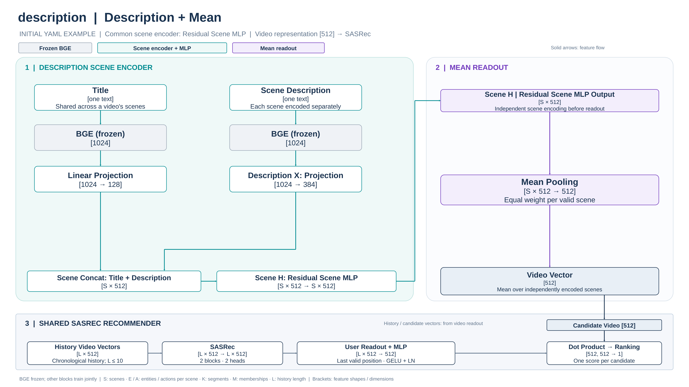
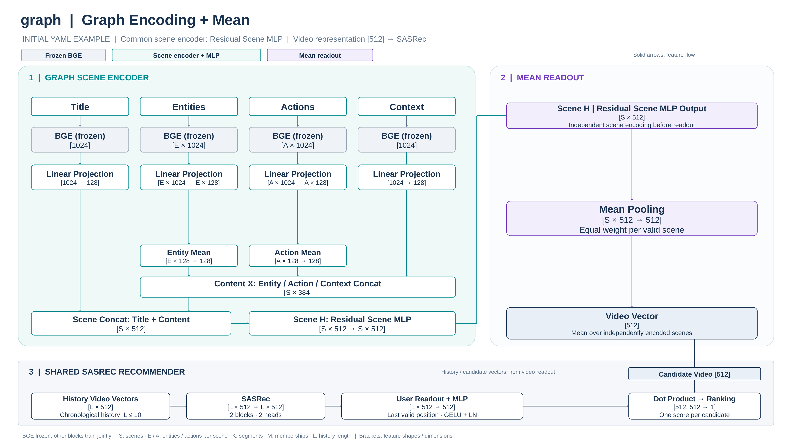
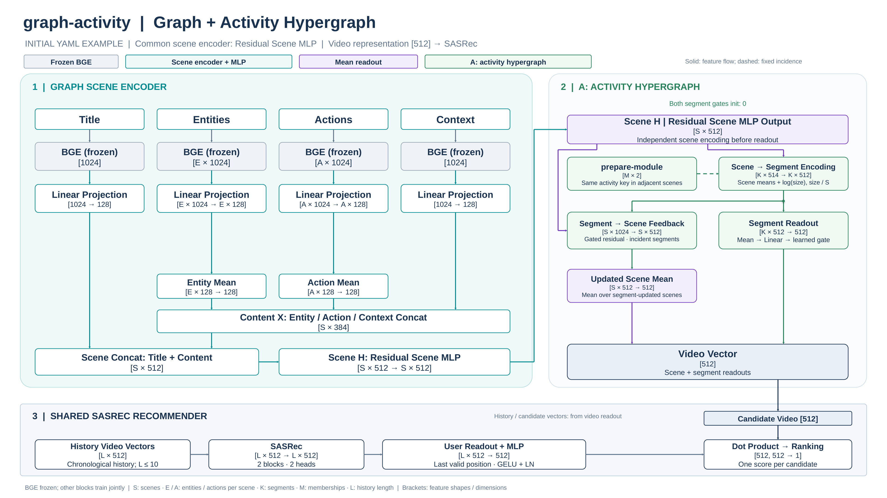
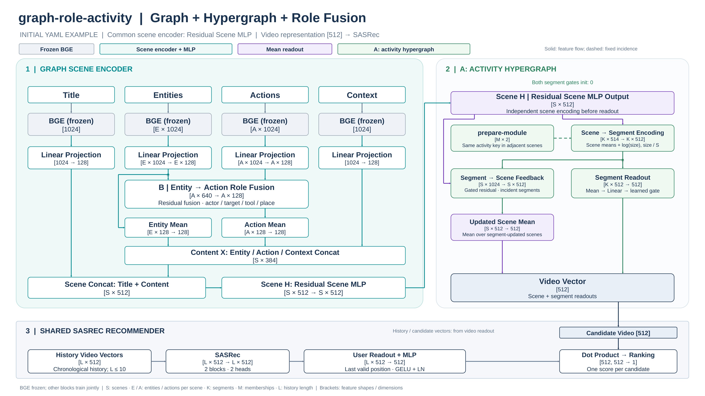

# 인코더·선택 모듈·추천 학습

실험 구성과 실행은 [README](../README.md)를 따릅니다. 이 문서는 입력 인코딩 → 선택 모듈 → 영상 집계 → 추천 학습을 설명합니다. 실험의 label은 이름이며 구조는 `source`, `modules`, `readout`으로 결정합니다.

## 고정 특징과 입력 인코딩

[BGE 인코더](../src/validation/features.py)는 로컬 모델로 1024차원 텍스트 특징을 생성합니다. BGE는 추천 학습에서 동결합니다. 특징 bundle은 동일 source의 실험들이 공유하며 학습된 장면·영상 벡터와 구분합니다. 아래의 학습 가능한 파라미터는 seed × 실험별로 독립적입니다.

| source 종류 | 영상 표현 경로 |
| --- | --- |
| metadata | 제목 BGE1024 → Linear512 → Residual MLP |
| Description | 제목1024→128 + 장면 문단1024→384 → 결합512 → Residual Scene MLP → 장면 평균 |
| Graph | 제목·Entity·Action·Context 각각1024→128 → Entity/Action 장면 내 평균 → 결합512 → Residual Scene MLP → 집계 |

Graph에 `role_fusion`이 있으면 Entity/Action 장면 내 평균 전에 역할 결합을 수행합니다. `activity_hypergraph`는 Scene MLP 뒤에 적용합니다. YAML의 모듈 나열 순서는 계산 순서를 바꾸지 않습니다. 현재 readout은 `mean`만 지원합니다.

장면 기반 경로는 `h = x + ReLU(Wx + b)`의 1층 Residual Scene MLP(512→512)를 사용합니다. 장면별로 독립 적용하며, 모듈이 없으면 이 MLP 자체가 장면 간 정보를 전달하지 않습니다.

### 결측과 fallback

Description은 요약 없이 장면 문단을 직접 사용합니다. Graph는 구조·경고 검사를 통과한 장면을 사용합니다. Graph와 Description은 각자의 유효 장면을 사용하며, 추천 단계의 관측 실패 때문에 catalog 아이템을 제거하지 않습니다.

유효 장면이 없으면 `SceneMLP([투영 제목; zeros384])` 경로를 사용하고, 제목도 없으면 영상 벡터는 0입니다. Graph의 유효 장면에 Entity·Action이 없으면 해당 슬롯을 0으로 둡니다. metadata는 제목만 사용하며 제목이 없으면 0 벡터입니다.

## role_fusion

장면 내부 Action의 actor·target·tool·place 역할을 사용합니다.

```text
role_input = [Action; actor Entity; target Entity; tool Entity; place Entity]  # 640
Action' = Action + ReLU(Linear_640_to_128(role_input))
```

연결이 없는 역할에는 absent/unknown 상태 임베딩을 사용합니다. Entity 자체는 갱신하지 않습니다. 모듈이 없으면 Fusion층·역할 상태 임베딩을 만들지 않으며 투영된 Action을 사용합니다. 이 모듈은 단독으로도 사용할 수 있고 장면 간 동일 개체 연결을 만들지는 않습니다.

## activity_hypergraph

활동 구간은 고정 전처리입니다. Action 문구에서 참여자 표식·일부 기능어를 제외한 첫 단어에 어미 제거·불규칙형 치환 규칙을 적용해 활동 키를 만듭니다. 같은 키가 연속된 원본 장면 번호에 나타나면 구간으로 묶습니다. 번호 단절이나 활동 재등장은 새 구간이며 길이 1 구간·중첩 구간을 허용합니다.

노드는 장면, hyperedge는 활동 구간입니다. S는 영상의 유효 장면 수, k는 구간입니다.

```text
u_k = ReLU(W_u [mean(h_s for s in k); log(|k|); |k|/S] + b_u)
h'_s = h_s + gate_scene * ReLU(W_s [h_s; mean(u_k for k containing s)] + b_s)
z = mean(h'_s) + gate_video * W_v mean(u_k)
```

구간에 속하지 않는 장면은 갱신하지 않습니다. 구간 기여는 구간별 동일 가중치 평균이며, 두 게이트는 0에서 시작하는 학습 가능한 스칼라입니다. 구간이 없는 영상은 장면 평균을 사용합니다. Scene MLP 출력이 모듈의 입력이며, 이 모듈이 현행 모델에서 장면 간 전달을 수행하는 경로입니다. 영상 노드와 Scene GCN은 만들지 않습니다.

구간은 `<source>` 특징 디렉터리의 `scene_segments.npy`·`scene_segments.json`으로 준비합니다. 구간 계약은 `scene-segments/v2`이며 입력 해시·생성 코드 해시·checksum을 검증하고 추천 identity에 포함합니다. source가 같으면 여러 실험이 구간 파일을 공유합니다. 준비는 VLM·BGE 재추론 없이 수행합니다.

활동 키는 문법 분석이나 동의어 병합 결과가 아닙니다. 동일 actor/target이나 시각적 행동 경계를 검증하지 않으므로 Hypergraph를 실제 사건 구조로 단정할 수 없습니다. [구간 생성](../src/validation/scene_segments.py) · [집계 정의](../src/validation/graph_context.py) · [영상 인코더](../src/validation/graph_model.py).

## 공동 학습과 실행 자원

512차원 영상 벡터로 과거 시청 이력을 구성하고, 위치 정보를 더해 SASRec으로 처리합니다. 마지막 유효 위치에 User Residual MLP를 적용해 512차원 사용자 벡터를 만들며 후보 영상 벡터와의 내적으로 점수를 계산합니다. SASRec·User MLP의 LayerNorm은 유지합니다.

학습 가능한 투영층·장면 인코더·선택 모듈·SASRec은 추천 loss로 함께 갱신합니다. 장면 인코더나 집계를 별도로 사전 학습하는 단계는 없습니다. 장면 내 역할, 영상 내 장면 관계, 사용자 시청 순서는 서로 다른 처리 범위입니다.

학습 손실은 인기도 보정 인배치 Cross-Entropy입니다. 같은 배치의 정답 아이템을 후보로 사용하고 내적 점수에서 `log Q(item)`을 뺍니다. Q는 입력 이력이 있는 학습 전이의 정답 빈도를 정규화한 확률이며 validation/test는 제외합니다. 자신의 정답 열을 유지하고 같은 정답의 중복 열과 최대 10개 입력 이력의 후보를 negative에서 마스킹합니다.

AdamW(`weight_decay=0.1`)와 gradient norm 제한 5.0을 사용합니다. 학습률·배치 크기·최대 epoch·patience·min_delta·seed는 [config.yaml](../config.yaml)의 `validation.model`을 따릅니다. checkpoint 선택은 실제 최고 validation 점수로, 조기 종료의 진전 판단은 `min_delta`로 구분합니다.

`validation.graph_execution.chunk_items`, `chunk_nodes`는 chunk 크기를 제한하며 한 영상 내부의 장면은 분할하지 않습니다. `checkpoint: auto`는 GPU 여유 메모리에 따라 activation checkpoint 여부를 정합니다. `chunk_scene_pairs`는 이전 설정 호환을 위해 받지만 현재 모델에서는 사용하지 않습니다. BGE 특징 캐시·chunk·checkpoint는 실행 자원 설정이며, 모델 조합은 추천 실험 YAML에서 정의합니다.

[모델](../src/validation/model.py) · [학습·checkpoint 선택](../src/validation/leave_one_out_recommendation.py) · [공통 optimizer](../src/validation/recommendation.py) · [조기 종료](../src/validation/early_stopping.py).

## 평가와 결과 해석

원본 이력이 5개 이상인 사용자의 최근 13개 interaction을 보존합니다. 동일 timestamp는 원본 이벤트 순서로 정합니다. 보존된 사용자 이력의 마지막 두 이벤트를 validation/test로 보류합니다.

| 단계 | 정답·역할 | 입력 이력 |
| --- | --- | --- |
| Train | 마지막 두 개를 제외한 다음 아이템 전이 학습 | 각 정답보다 앞선 이력 |
| Validation | 끝에서 두 번째 이벤트, HR@10 checkpoint 선택 | train 이력 |
| Test | 마지막 이벤트, 선택된 checkpoint의 최종 평가 | train + validation 이력 |

각 정답 앞의 최대 10개를 모델에 입력하며 첫 이벤트는 학습 정답으로 쓰지 않습니다. 동점이면 최초 최고 epoch를 유지하고 최적 checkpoint로 test를 한 번 평가합니다. validation 후 refit은 하지 않습니다. 후보 catalog는 보존된 사용자 시퀀스 전체의 아이템입니다. 사용자별 분할은 사용자 사이의 공통 시간 경계를 보장하지 않습니다.

평가에서는 모델 입력 길이와 별개로 앞선 보존 이력 전체를 마스킹합니다. 반복 정답도 예외를 두지 않고 `torch.argsort(scores, descending=True)`로 전체 catalog를 정렬합니다. 동률 순서는 환경 간 일치를 보장하지 않으며, 작은 catalog에서는 마스킹된 정답도 cutoff 안에 들어갈 수 있습니다. 구현은 [이력·분할](../src/validation/leave_one_out_data.py), [마스킹·랭킹](../src/validation/leave_one_out_execution.py)을 따릅니다.

NDCG@10·HR@10의 seed별 값·평균·표본 표준편차를 보고합니다. metadata source 실험은 이름에 관계없이 상대 변화율의 기준이며, 없으면 상대 변화율을 생략합니다. NDCG@10은 사용자별 seed 평균에 paired bootstrap을 적용하고 전체 실험 쌍에 Bonferroni 보정합니다. HR@10은 기술통계입니다. 실험 수가 달라지면 비교 쌍 수와 보정 신뢰수준도 달라집니다.

다음은 초기 YAML 구성의 비교 해석 예시입니다. 보고서는 특정 이름을 우선 비교 대상으로 고정하지 않고 기록된 구성과 모든 쌍을 표시합니다.

| 비교 예시 | 포함되는 차이 |
| --- | --- |
| graph − description | 추출 내용·투영 구조·장면 확보율 등 입력·인코딩 차이 |
| graph-activity − graph | Role Fusion 없는 상태의 Hypergraph 전달과 구간 기여 전체 |
| graph-role-activity − graph-activity | Hypergraph가 있는 상태에서 Role Fusion 추가 |

Hypergraph의 연결 구조와 두 내부 경로의 효과를 각각 분리한 비교는 아닙니다. 파라미터 증가도 포함하며 각 효과를 단순 합산하지 않습니다. 관측·인코딩·학습 결과·후속 가설을 구분하고, 진단 pass를 시각적 grounding이나 추천 성능 개선의 증명으로 해석하지 않습니다.

## 초기 구성의 구조 그림

아래는 초기 설정의 예시입니다. 사용자 정의 조합에 맞춰 자동 갱신되지 않으며, 기존 문서 링크를 위해 이미지 파일명을 유지합니다. [생성 소스](design/generate_graph_arm_diagrams.py).

<details>
<summary>description — 제목·장면 문단 → Scene MLP → Mean</summary>



</details>

<details>
<summary>graph — Graph 인코딩 → Scene MLP → Mean</summary>



</details>

<details>
<summary>graph-activity — 활동 Hypergraph 추가</summary>



</details>

<details>
<summary>graph-role-activity — 역할 결합과 활동 Hypergraph</summary>



</details>

## 설계 배경과 과거 구조 대응

이전 연구실 자문의 모듈 번호는 당시 논의의 구분이며 현재 실행 단계나 YAML 모듈 목록과 같지 않습니다.

| 당시 논의 | 현재 구현과 대응 | 확인이 필요한 범위 |
| --- | --- | --- |
| 역할 분해 Graph의 추천 활용성 | Context·Entities·Actions와 역할 기반 Action 인코딩 | 시각적 관측의 정확도·추천 기여 |
| 장면 유사도 기반 GCN aggregation | 현행 모델은 선택적 활동 Hypergraph로 장면 간 전달 | 연결·전달·구간 기여의 개별 효과 |
| 사용자·아이템의 공통 feature space | SASRec 사용자 벡터와 후보 영상 벡터의 내적 | 표현·학습 조건을 맞춘 비교 |

graph-role-activity의 계산·초기화 기준은 과거 `clab-insight`의 `hyper-g5` 커밋 `486c541`에 등록된 G5입니다. 두 모델은 Role Fusion → Scene MLP → Hypergraph → 장면 평균 + 구간 기여를 수행합니다. 구간 파라미터는 별도 난수 생성기로 초기화합니다. 코드 정합성은 과거 Run의 NDCG를 재현했다는 뜻이 아니며, 이전 Arm 이름의 결과를 새 label로 변환하지 않습니다.

현재 구조·기본 차원에서 학습 파라미터는 metadata·Description·기본 Graph가 각각 7,624,704개이고, 활동 Hypergraph는 1,050,626개, Role Fusion은 83,072개를 추가합니다. 고정 BGE는 포함하지 않으며 실제 실험의 파라미터 수는 학습 결과를 확인합니다.

장면 간 개체·사건 관계, 영상 간 노드 공유·어휘 정규화, 다른 GNN 구조나 사용자 모델 비교는 현행 구현과 구분되는 후속 검토입니다. [프로젝트 이정표](TODO.md)의 구현 상태와 실험 기록을 참고하세요.

CPU·가짜 BGE 검증은 수식·gradient·장면/영상 경계·fallback·소규모 실행과 캐시·진단을 점검합니다. 실제 추출의 시각적 정확도, CUDA 처리량과 전체 데이터 성능 우위는 별도 실험으로 확인해야 합니다. 저장·재현성 규칙은 [실행·저장 계약](runtime.md)을 참고하세요.
